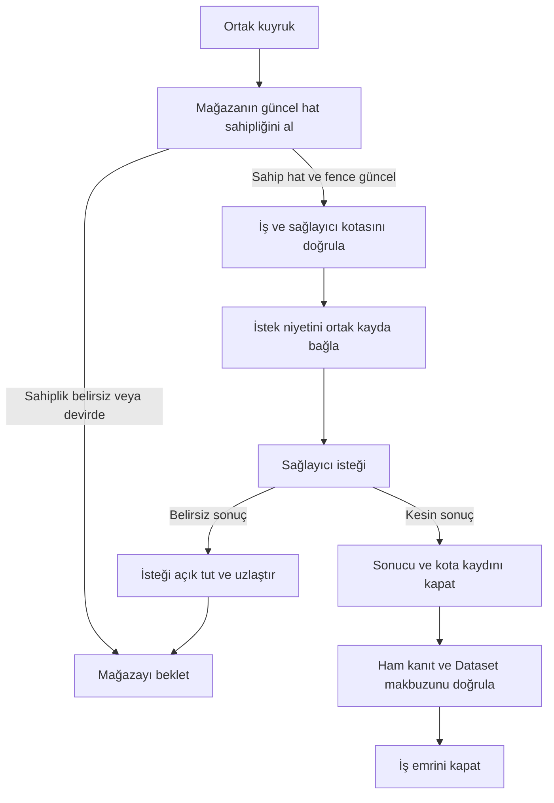

# EO-05A çoklu refresh hattı tasarımı

**Bir Shopify mağazasının Google Ads, Klaviyo ve Meta refresh işleri aynı anda yalnızca tek hatta aittir.** Hat değişimi, önceki hattın açık işlerinin, isteklerinin ve yazımlarının güvenli biçimde sonuçlandığı doğrulanınca yapılır. Kural, sağlayıcıya istek gönderilmeden önce uygulanır. Bu belge tasarım kaydıdır. [Günlük refresh sözleşmesi](EO_05A_REFRESH_CONTRACT.md) · [Makine sözleşmesi](../contracts/eo-05a-global-refresh-design-v1.json#multi_lane_refresh_design_2026_11_21)

## 1. Mağaza sahipliği ve iş dağıtımı

- Ortak iş dağıtımı, aktif Shopify kurulumunun kanonik mağaza kimliğini kullanır. Sahiplik anahtarı mağaza düzeyindedir. Sağlayıcı, reklam hesabı, iş günü ve veri seti aynı mağazaya ek hat sahipliği vermez. Kurulum nesli, mağaza kaydında doğrulanır. Eski neslin çağrıları veya yazımları belirsizken yeni nesil ayrı bir sahiplik alanı açmaz.
- Kontrol kaydı en az mağaza kimliğini, geçerli kurulum neslini, sahip hattı, artan sahiplik sürümünü (`fence`), sahiplik durumunu ve açık iş/istek ilişkilerini taşır. Atama ve değişiklik tek atomik karar olarak yapılır. Hatların kendi belleğindeki, önbelleğindeki ve veri veritabanlarındaki kopyalar yalnız gözlem içindir.
- Dağıtım aynı mağaza için iki hatta paralel sahiplik veremez. Hat planı farklı mağazaları paralel işleyebilir. Mağazanın üç sağlayıcı işi aynı hatta kalır. Sağlayıcı ve raporlama hesabı başına tek aktif iş kuralı bunun içinde ayrıca geçerlidir. Bir hatta mağaza içi sağlayıcı paralelliği ayrı kapasite kararıdır.
- Hat ataması uzun ömürlüdür. Her kuyruk kontrolünde yeniden dağıtım yapılmaz. Boşa çıkan işler, yeni mağazalar ve güvenli devri tamamlanan mağazalar kapasiteye göre atanabilir. İş günü içinde devir gerçekleşirse mevcut kapanmış işler ve makbuzlar yeni hatta taşınan iş planında korunur.
- İlk kapasite değerlendirmesi birden fazla hat ve ortak kontrol kaydıyla yapılabilir. Veri veritabanı sayısı, hat sayısı ve mağaza dağıtım algoritması ölçümle seçilecek uygulama kararlarıdır.

## 2. Her dış istekte gönderim kontrolü

1. Worker işe alırken mağaza, geçerli kurulum nesli, hat, sahiplik fence’i, iş fence’i, sağlayıcı hesabı, gün ve iş son tarihini ortak kontrolden doğrular.
2. **Her fiziksel istek öncesinde** aynı mağaza sahibi ve güncel fence yeniden doğrulanır. Bu kontrol rapor, sayfalama ve gerekli abonelik/izin doğrulama isteklerini kapsar. Aynı işlem için iş kimliği, istek türü ve sayfa ya da deneme kimliği korunur.
3. Ortak kontrol, mağazanın yeni istek kabul ettiğini doğrular. Kota rezervasyonunu ve gönderim niyetini güncel sahiplik altında bağlar. Aynı istek için yeniden teslim edilmiş bir kuyruk mesajı ikinci gönderim hakkı oluşturmaz. Güncel karar doğrulanamazsa dış çağrı çıkmaz.
4. Gönderim niyeti kalıcı olduktan sonra HTTP çağrısının sonucuna kadar istek devir açısından açıktır. Kontrol işlemi HTTP boyunca kilit tutmaz. Worker, kontrol ile fiilî gönderim arasında durmuş olsa bile açık niyet yeni hattın aynı işi göndermesini engeller.
5. Kesin sonuçta istek ve kota kaydı birlikte doğrulanır. Sonucun belirsiz kaldığı çağrı otomatik yeniden gönderilmez. Gönderim izninin kesin olarak iptal edildiği veya eski yürütmenin sona erdiği ve çağrının durumunun uzlaştırıldığı kanıtlanana kadar sahiplik devredilmez.
6. Ham kayıt, rapor yayını ve kapanışta güncel hat ve iş fence’leri de doğrulanır. Gecikmiş bir worker, mağazanın artık kullanmadığı yetkiyle rapor yazamaz veya bir günün kapanışını ilerletemez. [Kesinti sözleşmesi](../contracts/eo-05a-refresh-interrupted-work-v1.json)

## 3. Hat devri ve hata halinde izolasyon

| Durum | Ortak kontrolün kararı | Sonraki hat |
|---|---|---|
| Hat sağlıklı | Mevcut sahiplik devam eder. Aynı mağazanın işleri sahibine yönlendirilir. | Bekler. |
| Planlı devir | Mağaza yeni gönderime kapatılır. Açık istekler, sonuçlar, ham yazımlar ve rapor makbuzları uzlaştırılır. | Sıfır açık ya da belirsiz işlem ve doğrulanmış devir koşullarıyla yeni fence alır. |
| Hat öldü veya bağlantısı koptu | Yeni gönderim durdurulur. Son kesin iş aşaması ve açık istekler korunur. Süre dolması yürütmenin veya HTTP çağrısının durduğuna kanıt sayılmaz. | Eski işin durumu kesinleşene kadar mağazayı çalıştırmaz. Diğer mağazalar kalan bütçeyle ilerleyebilir. |
| Devir sırasında kontrol veya hedef veri veritabanı erişilemedi | Son kesin sahibi ve tüm kanıtları koru. Yeni gönderim izni kapalı kalır. | Eksik kanıt giderilip devir tamamlandığında işe başlanır. |
| Eski mesaj veya worker geri döndü | Eski nesil ve fence reddedilir. Mesajın durumu mevcut iş ve istek kaydı üzerinden okunur. | Yeni sahipliği etkilenmez. |

Planlı devirde önce mağazanın gönderimi kapatılır, sonra açık işlemler uzlaştırılır. Kapanmış günlerin makbuzları ve bekleyen işlerin listesi doğrulandıktan sonra yeni sahip ve daha yüksek fence tek kararda kaydedilir. Yeni hattın ilk isteği bu kararın doğrulanmasından sonra çıkabilir.

## 4. Ortak kotalar ve birden fazla veri veritabanı

- **Tek ortak kontrol.** Kuyruk sahipliği, gönderim niyeti ve kota rezervasyonu aynı otorite üzerinden yürür. Kontrol kaydına ulaşılamadığında hatlar yeni istek gönderemez. Bir veri veritabanından diğerine geçmek bu kuralları değiştirmez.
- **Paylaşılan kota.** Google Ads’te proje ve müşteri hesabı, Klaviyo’da hesap ve endpoint/app kurulumu, Meta’da uygulama ve reklam hesabı kullanım sinyalleri ile Shopify Partner istemcisi ortak sayaç kapsamlarında izlenir. Aynı sağlayıcı hesabı birden fazla mağaza kaydında kullanılıyorsa o hesabın sağlayıcı kotası ortak kalır. Canlı tasarım, yayımlanan en yüksek erişim seviyelerini ve ilgili endpoint sınırlarını esas alır. Sabit hat sayısı gerçek istek hızı, kaynak bütçesi ve kapanış süresiyle belirlenecek. [Google Ads](https://developers.google.com/google-ads/api/docs/productionize/rate-limits) · [Klaviyo](https://developers.klaviyo.com/en/docs/rate_limits_and_error_handling) · [Meta](https://developers.facebook.com/docs/graph-api/overview/rate-limiting/#ads-insights) · [Shopify Partner](https://shopify.dev/docs/api/partner/latest#rate-limits)
- **Tek etkin yazım hedefi.** Veri birden fazla veritabanına dağıtılırsa bir mağazanın ham kayıtları, Dataset satırları ve makbuzları için tek etkin hedef vardır. Hedef kimliği, geçerli sahiplik sürümüne bağlıdır. Planlı hedef değişiminde önce eski hedefte yeni yazımlar kapatılır ve bekleyen yazımlar kesinleşir. Kanıtlar doğrulanıp yeni hedefin fence’i hazırlandıktan sonra ortak yönlendirme güncellenir.
- **Yarım geçiş.** Hedef değişimi yarıda kalırsa mağaza bekler. Eski ve yeni hedef aynı anda yazım almaz. Yeniden dağıtım, son kesin durum ve doğrulanmış makbuzlarla ilerler. Her hedefteki bağımsız sayaçlar veya kilitler mağaza sahipliğini ve ortak kotayı belirlemez.

## 5. Uygulama öncesi kabul senaryoları

| Senaryo | Aranacak kanıt |
|---|---|
| İki hat aynı mağazayı aynı anda ister | Tek atama ve tek güncel fence. Kaybeden hattan sıfır sağlayıcı çağrısı. |
| Üç sağlayıcının işleri farklı hatlara teslim edilir | İşler aynı mağaza sahibi hatta yönlenir. Diğer hatlardan sıfır çağrı. |
| Aynı kuyruk mesajı yeniden gelir | Aynı iş ve istek kimliği ikinci bir gönderim izni üretmez. |
| Worker çağrıdan hemen önce durdurulur veya ağda gecikir | Açık gönderim niyeti yeni hattı engeller. Eski çalışmanın geçerli olmadığı ve açık işlemin uzlaştırıldığı doğrulanmadan ikinci çağrı çıkmaz. |
| Sağlayıcı yanıtı veya ham/rapor makbuzu kaybolur | Belirsizlik kaydı açık kalır. Aynı istek tekrar gönderilmez ve iş bitmiş sayılmaz. |
| Planlı devirde eski worker geç döner | Yeni fence’in önceki işlemi reddettiği görülür. Doğrulanmış rapor ve iş makbuzları korunur. |
| Farklı mağazalar ortak sağlayıcı kotasına yüklenir | Hatlar paralel ilerleyebilir. Tüm hatların toplamı ortak kota sınırında tutulur. |
| İki veri hedefi arasında geçiş yarıda kalır | Aynı anda tek yazım hedefi vardır veya mağaza durmuştur. Aynı gün için iki makbuz veya çift yazım oluşmaz. |
| Ortak kontrol erişilemez | Hat, önbellekte eski sahiplik görse bile yeni sağlayıcı çağrısı çıkarmaz. |

Ortak prova **tek mağaza, tek hat ve 40,621 saniyelik** sentetik referanstır. Çoklu hat yarışları, başa çıkılabilir kota hızı, hedef değişimi, bağlantı kaybı ve canlı kapasite için kabul senaryoları yukarıda tanımlıdır. Ölçüm ve kapasite kararı rapor yüküyle EO-07 sonunda, gerekirse EO-08 sonunda ele alınacak. [Tek hat prova kaydı](https://github.com/fyilanli-oss/ads-table-embedded/actions/runs/44914944926/job/136878434619)

PostgreSQL işlem ve kilit belgeleri ile sağlayıcı kota belgeleri 21 Kasım 2026’da kontrol edildi. [PostgreSQL işlemleri](https://www.postgresql.org/docs/17/tutorial-transactions.html) · [PostgreSQL kilitleri](https://www.postgresql.org/docs/17/explicit-locking.html) · [Supabase RLS](https://supabase.com/docs/guides/database/postgres/row-level-security)
