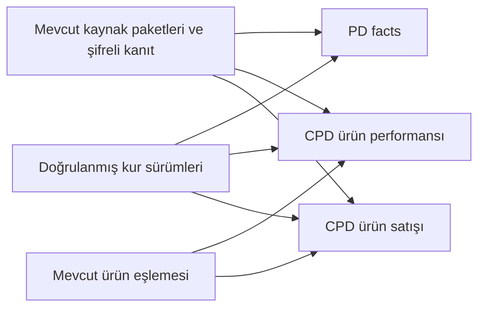

# EO 05 B beş tablo tasarımı

Bu tasarımın amacı, depodaki doğrulanmış kaynağı rapor verisine dönüştürecek beş
ana tabloyu kurarken yeni sağlayıcı alanlarına da yer bırakmaktır. Temel kimlik ve
metrikler tipli kolonlarda, sonradan eklenen isteğe bağlı metrikler ise sürümlü ve
doğrulanan JSONB bölümünde tutulacaktır.

Durum: **ürün sahibinin ayrıntılı yerleşim incelemesine sunulan öneri**.
Bu teslim tablo oluşturmuyor, mevcut eşlemeyi taşımıyor ve veri yazmıyor.
Tam kolon ve ilişki tanımları [makine sözleşmesindedir](../contracts/eo-05b-five-table-design-v1.json).

## Beş tablo ve bir satırın anlamı

| Tablo | Bir satır neyi temsil eder? | Yapılacak işlem |
|---|---|---|
| `analytics.pd_facts` | Aynı gün ve aynı raporlama kapsamında doğrulanmış bir reklam/mesaj düzeyinin performansı. | Yeni tablo önerisi. |
| `analytics.cpd_product_performance_facts` | Kaynağın gerçekten verdiği ürün ve reklam kapsamının günlük gösterim, tıklama ve maliyet gözlemi. | Yeni tablo önerisi. |
| `analytics.cpd_product_sales_facts` | Kaynağın verdiği ürün satışı: günlük toplulaştırılmış satış veya tek Ordered Product olayı. | Yeni tablo önerisi. |
| `identity.product_identity_mappings` | Native ürün kimliğinin belirli kanıt ve sürümle Shopify ürününe eşlemesi. | Mevcut tablo ve doğrulama yolu aynen kullanılır. |
| `analytics.fx_rates` | Belirli para çifti, tarih, kaynak ve sürüm için doğrulanmış kur. | Yeni tablo önerisi. |

Beş mantıksal ailenin dördü yeni tablolar olacaktır. Daha önce kurulan on kaynak/kanıt
tablosu yerinde kalır; eşleme tablosu iki katmanda ortaktır. Bu iki katmanın toplamı
14 tablodur. Oturum, bağlantı, kuyruk, kota ve diğer operasyon tabloları bu sayıya
dahil değildir. Her provider için aynı tabloların kopyaları veya altıncı bir kalıcı
toplam tablosu kurulmaz.

Önceki [beş tablo kolon sözlüğü](research/PD_CPD_QUERY_WORKING_TABLE_2026-10-22.md)
tarihsel tasarım olarak korunur. Bu öneride mevcut eşleme migration'ı onun eski
kolon listesinden üstündür; uygulanmış eşleme tablosuna eski taslak kopyalanmaz.

## İlişkiler



Üç fact tablosu kaynak paketine mağaza/kurulum/nesil dahil ilişkiyle bağlanır. Birleşik
PD kaydının diğer kaynak paketleri de metrik bazlı izde korunur ve işlem sırasında
doğrulanır. Tek `source_batch_id`, bütün metriklerin tek kaynaktan geldiği anlamına
gelmez.

Ürün performansında tek ürün eşleme bağlantısı; satışta satılan ve reklamı yapılan
ürün için iki ayrı bağlantı vardır. Yalnız bigint ID eşleşmesi yeterli değildir:
mağaza, kurulum ve nesil aynı olmalı, eşleme ilgili hesap/kaynak kuralı için geçerli
olmalıdır. Eşleme henüz çözülememişse native veri korunur; Shopify ürünü uydurulmaz.

CPD Channel bağlantısı zorunlu bir PD fact ID'si değildir. Kaynağın vermediği ilişki
yaratılmaz. PMax Campaign'i Asset Group yerine yazılamaz. Rol, ürün eşlemesi ve
Channel farklı kanıtlarla çözülür.

Kur bağlantısı yalnız belirli, değişmez kur sürümüne gider. Kaynak kanıtı olmayan
kur veya ürün eşlemesi için sahte destek satırı oluşturulmaz. Bu iki bağlantının
eksik olması, kaynağın kendisinin silinmesini gerektirmez; ilgili raporlama işlemi
hazır sayılmaz.

## Üç veri tablosunun ortak alanları

| Alan grubu | İçerik ve kural |
|---|---|
| Sahiplik | `workspace_id`, `installation_id`, `installation_generation`, provider bağlantısı ve native hesap. Güncel sunucu yetkisiyle doğrulanır. |
| Native kimlik | `source_identity`, `grain_version`, canonical kaynak anahtarı ve hash'i. Kimlik metrik tutarından bağımsızdır. |
| Tarih ve kapsam | Gerçek iş günü/saat dilimi ile raporlama zamanı, attribution/conversion ve birim kapsamı. Bunlar birbirinin yerine geçmez. |
| Temel metrikler | Sayısal kolonlar; her metriğin destek ve gözlem durumu ayrıca bulunur. Eksik değer sıfır olmaz. |
| Ek metrikler | `metric_extensions` ve `extension_schema_version`; yalnız tanımlanmış isteğe bağlı alanlar. |
| Kaynak izi | Kaynak paketleri, sorgu/şema/adaptör sürümleri, bütünlük kanıtı ve tamlık durumu. Ham gövde tekrar kopyalanmaz. |
| Para birimi ve kur | Kaynak/raporlama para birimi, belirli kur satırı, kur durumu ve hesaplama sürümü. |
| Sürüm ve süre | İçerik özeti, kayıt revizyonu, oluşturma/güncelleme zamanı ve açık politika sürümüne bağlı son saklama tarihi. |

Kurulum ID'si mevcut DB'deki bigint'tir; uygulamalar arasında canonical ondalık
metin olarak taşınır. Shopify/provider kimlikleri görünüşleri sayı olsa bile text
kalır. Raporlama hesabının native metin kimliği, dahili binding bigint ID'si değildir.
Mevcut Klaviyo NULL kuralı korunur.

## Temel metrikler ve sağlayıcı sınırları

PD'nin temel kolonları mevcut dokuz metriktir: `impression`, `ad_click`,
`spend_value`, `add_to_cart`, `add_to_cart_value`, `checkout`, `checkout_value`,
`purchase`, `purchase_value`.

CPD ürün performansı `impression`, `click`, `spend_value` tutar. Ürün satışı
`sales_quantity`, `sales_value` tutar; native normal/all/cross-sell gibi kaynak
alanları kendi kapsamıyla ayrıca korunur. Aynı tutar ikinci satış diye eklenmez.

Search reklam maliyeti ürüne kopyalanmaz. Klaviyo için olmayan ürün gösterim/tıklama
satırı yaratılmaz. Meta'nın henüz anlamı kanıtlanmamış dört dönüşüm alanı normal
ürün satışı diye zorla eşlenmez. Unclassified rol/Channel, eksik kanıtın yerine
tahmin yürütmeden kaydı korumayı sağlar; yeni native anlam kanıtı üretmez.

Parasal tutarlar kaynak para biriminde ve kaynak hassasiyetini kaybetmeden saklanır.
PostgreSQL `numeric` ve kayıpsız ondalık metin taşıma önerilir; metrik başına biçim,
boyut ve sonluluk kontrolü yapılır. Kaynak dönüşüm adetleri kesirli olabilir; hepsi
integer'a zorlanmaz. Mevcut JS number adaptörünün kullanılması tek başına kayıpsızlık
kanıtı değildir. Yuvarlama rapor/formül kuralında yapılır.

## Yeni alan ekleme örneği

Örneğin Meta'dan aynı gün/reklam düzeyinde yeni bir isteğe bağlı metrik almak
istersek, kayıt biçimi şu düzende genişleyebilir. Aşağıdaki isim ve birim örnektir;
gerçek provider desteği veya yeni sorgu onayı değildir:

```json
{
  "extension_schema_version": "reviewed-registry-v2",
  "metric_extensions": {
    "meta.example_optional_metric": {
      "value": "12.25",
      "value_type": "decimal",
      "unit": "registered source unit",
      "support": "supported",
      "observation": "present",
      "source_references": ["existing bounded source reference"]
    }
  }
}
```

Yeni alanın adı, tipi, birimi, kaynak kanıtı ve eksik değer anlamı sürümlü sözleşmede
tanımlanır. Onaylı sorgu/alan seçimi ve yazıcı/okuyucu desteği güncellenir. Aynı satır
düzeyindeki isteğe bağlı metrik çoğunlukla tablo migration'ı gerektirmez; yine de
kodsuz veya kontrolsüz kabul edilmez. JSONB metrik tanımları repository'de tutulur;
ayrı altıncı registry tablosu önerilmez.

Ek alanlar temel metriğin adını veya sahiplik, native kimlik, para birimi, güvenlik
ve rol alanlarını gölgeleyemez. İlk öneri satır başına 32 ek anahtar ve 16 KiB ek
alan sınırıdır; taşan içerik kesilerek başarı sayılmaz. Tanımsız alan reddedilir veya
eldeki ham kanıt kapsamında bekletilir. Secret/PII için ek alan bir kaçış kapısı değildir.

Eski şemadaki kayıt okunmaya devam eder. O dönemde istenmeyen alan sıfır sayılmaz.
Yeni alan eski zarfta toplanmamışsa sonradan varmış gibi üretilemez; gerektiğinde
ayrı onaylı native okuma gerekir. Eski verinin anlamını değiştiren isim/tür/birim
değişikliği yeni tanım/sürüm ister.

Bir metrik yoğun sorgulanan temel kolona alınacaksa migration ve indeks kararıyla
taşınır; eski ve yeni gösterimin raporda tek bir otoriter okuma yolu olur. İki kopya
iki kez toplanmaz.

## Yeni metrik ile yeni satır düzeyi farklıdır

Yeni video metriği mevcut satıra ek bilgi olabilir. Fakat ülke başına ayrı satır
istenmesi verinin düzeyini değiştirir: tekillik, sorgu ve toplama kuralları yeniden
incelenir. Yeni boyut `metric_extensions` içine gizlenemez. Bu durumda anahtar ve
şema düzenlemesi gerekebilir; her değişiklik için migration'sızlık sözü verilmez.
Eski/yeni kayıt düzeyi birlikte tutulursa rapor tek kabul edilmiş sürümü kullanır;
iki sürümün satırları birbirine eklenmez.

Tekrar önleme anahtarı native mağaza/kurulum/nesil/provider/hesap ve gerçek kaynak
satırı düzeyine dayanır. Günlük raporda gün ve kapsam önemlidir. Klaviyo olayında
native event ID önemlidir; günü sonradan çözmek ikinci olay oluşturmaz.

Metrik tutarı, ek alan sürümü, görünen ad, kur sonucu, iş/attempt kimliği, sonradan
çözülen rol, Shopify eşlemesi veya Channel native kimliğe eklenmez. Hesap aynıyken
credential/connection revizyonu değişti diye aynı native satış tekrar yaratılmaz.
Güncel yetki her yazmada ayrıca doğrulanır; bu kural Disconnect dönemine geriye
dönük veri çekme yetkisi vermez.

Canonical anahtar ve hash birlikte kontrol edilir. Aynı anahtar/farklı içerik körlemesine
üzerine yazılmaz; revizyon/çakışma ve gerçek tekrar kontrolü mevcut EO-05-C/D
protokolüne bağlanır. Aynı kaynağı örten iki sorguya farklı aile adı vermek, iki ayrı
satışı kanıtlamaz. Kaynak düzeyi kanıtlanamıyorsa ham kayıt korunur ve kabul edilmiş
fact yazılmaz.

## Kur, saklama ve silme

`fx_rates` yalnız gerçek kur kanıtını ve sürümünü tutar. Bu öneri Frankfurter veya
başka bir sağlayıcı seçmez. Kur kaynağı, kapsanan para birimleri, tatil/eksik gün ve
mevcut raporlama para birimi kilidinin doğrulanması mevcut EO-05-B işidir.

Aynı para birimi için öneri açık identity durumudur: çarpan 1, dış kur satırı yok.
Kur eksikse native tutar saklanabilir; kur dönüştürülmüş rapor hazır sayılmaz.
Kaynak tutar yerinde kalır, yeni kur eski kanıtı veya geçmiş hesaplamayı sessizce
değiştirmez. Güncel/önceki gün kuruna otomatik düşme yoktur.

Kaynak deposunun 90/365 kararı değişmez. Yeni fact katmanının saklama süresi UI'daki
90 günlük sorgu aralığından otomatik türetilmez: aktivasyondan önce açık politika
sürümü ve sonlu `retain_until` zorunludur. Okuma/tekrar/ek alan zenginleştirmesi eski
kaydın süresini kendiliğinden yenilemez. Bu teslim yeni süre veya silme işi çalıştırmaz.

Yeni tablolar yazıma açılmadan önce fact ve ek alan içerikleri mevcut gizlilik silme
envanterine ve scoped worker'a bağlanır. Zorunlu silme normal saklamadan önce gelir.
Bağımlı fact'ler uygun sırayla kaldırılmadan kaynak/eşleme silinmez; olağan süre
temizliği kör cascade ile yapılmaz. Yeni silme motoru kurulmaz. Yedek/restore ve
gerçek müşteri teslimi için kabul edilmiş EO-08-C ve EO-07-A/EO-08-D ertelemeleri kalır.

## Uygulama sırası ve bu teslimin bitişi

Bu teslimin somut sonucu beş tablonun alanları, ilişkileri, tekillik ve genişletme
kurallarıdır. Ürün sahibi bu yerleşimi gördükten sonra dört yeni tablo ve yazıcı
uygulamasına geçilir. İlk uygulamada sahiplik, ondalık doğruluk, NULL/sıfır, yeni ek
alanla aynı native anahtar, eski sürüm okuma, rollback/unknown, consumer makbuzu ve
zorunlu silme davranışları gerçek SQL/yazıcı testleriyle kanıtlanacaktır.

Mevcut ortak adaptör FX ve ad ister; bu belge onu gevşetmez. Storage DTO ile rapora
hazır canonical fact ayrı tutulacaktır. Native kayıt, kaynak makbuzu, eşleme/kur
hazırlığı ve rapor tüketim makbuzu birbirinin yerine geçmez. Kalıcı tüketim ve
checkpoint gerçek kabul olmadan ilerlemez.

1–26 kaydı **Ayrıntılı kontrol listesi** olarak kalır; tamamlanan iş ilerledikçe
ilgili EO paketine PR/test kanıtıyla işlenir. 23, EO-05-B/C/D ile ilişkilidir. Bu
tasarım onların tümünü, 23'ü veya EO-05-B'yi tamamlandı yapmaz. Yeni paket yoktur.
Provider sorguları, OAuth, UI, canlı SQL/config, yayın ve merge bu teslimle değişmez.

Resmî mekanizma kontrolü 8 Kasım 2026:
[PostgreSQL JSON tasarımı](https://www.postgresql.org/docs/current/datatype-json.html#JSON-DOC-DESIGN),
[constraints](https://www.postgresql.org/docs/current/ddl-constraints.html),
[numeric](https://www.postgresql.org/docs/current/datatype-numeric.html),
[Supabase JSON doğrulaması](https://supabase.com/docs/guides/database/json).
Bu kaynaklar mekanizmaları açıklar; AdsTable'ın henüz uygulanmamış şemasını veya
provider alan desteğini onaylamaz.
