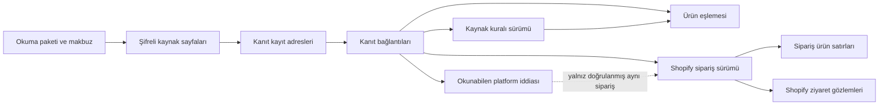

## 4 Kasım — tarayıcısız Merchant sunucu girişi analist özeti

Owner yalnız mevcut okuyucunun güvenli sunucuya bağlanması, kod/izole test/tek PR kapsamını onayladı. Başlangıç: mevcut Merchant-only yol Shopify browser authority ister; ham kayıt yolu ise Merchant hedefini önceden ister. Sonuç: özel sunucu POST, hazır private Google kurulum yetkisiyle seçili hesabın gerçek Merchant bağlantılarını okur.

Başlangıç/kapalı: plan, Production, Bearer veya input geçersizse DB/native0. Süresi dolmuş token: mevcut atomik identity yenilemesi bir kez, exact readback; sonra bir ilişki sorgusu. Başarı: complete ve güvenli ID/count; boş bağlantı ürün0 değildir. Çok bağlantı: liste, seçim yok. Hata/partial/stale/unknown: IDs/count null, retry veya ürün okuması yok. Abort/deadline: sonradan yanıt başarı yayımlamaz. Eski browser açıklama/seçim/modal/copy davranışları aynı kalır.

Görünür öğe, layout, copy veya Shopify component/property yok; bu yalnız görünmez resource route. Görsel veya EO07 kabulü üretilmez. Ortak özel request gate ve bounded runtime transaction kapıları yeniden kullanılır. Native sorgu/parser, token kasası/CAS, roller/grant'lar ve ham kayıt protokolü korunur. Kod route maxDuration60, çekirdek20s ve DB5s sınırındadır.

Kapsam dışı: yeni OAuth adımı/asset seçicisi, SQL migration/rol/tablo/anahtar/config, kaynak veya rapor yazımı, job/admission/scheduler, canlı Google çağrısı, deploy ve merge. Kabul:29 yeni odaklı test, eski Merchant/ham kayıt ve negatif regresyonlar; gerçek runtime/vault fonksiyonlarıyla8 SQL senaryosu üç mevcut F01 ortamında. Resmî Google product_link/refresh, React Router resource route ve Vercel preset belgeleri4 Kasım2026 kontrol edildi; linkler makine kaydında.

## 2 Kasım — mevcut 15: kontrollü Google kaynak–kural–eşleme akışı

Owner, hazırlık incelemesi sonrası bu tek Google akışının kod ve izole uçtan uca
test/PR paketini açıkça onayladı. Başlangıç main26659126eb0944ea8560f251169533e2ea270e99.
Kayıt: contracts/a6-eo-implementation-master-v1.json#Step15_Google_source_mapping_flow_2026_11_02.

Yeni özel sunucu bileşimi mevcut fenced Google/Merchant/Shopify SDK aday okuması
ve kaynak kaydını, kaynak kuralı inceleme/kaydını, eşleme inceleme/kaydını ve en yeni
native kimlikle geri okumayı birleştirir. Hedef, mevcut kaynakta bulunması gereken
tam güvenilir iş planı kimliğidir; yeni UI/asset seçicisi veya route değildir.

Gerçek Google kaynak yazıcısı başarılı sonuç veya belirsiz yazma hatası için özel
WeakMap kaydı oluşturur. Owner, attempt, yazılan typed kaynak kimlikleri ve gerçek
SQL makbuzu bu kayıtta bağlıdır. JSON kopyası veya bayrak bu kaydı üretemez. Hedef
tam bir kez bulunmalı ve unresolved olmalıdır; mapping id gerçek makbuzdan gelir.
Kural incelemesi reviewer çağrısından önce exact expectedSourceBatchId karşılaştırır;
eski mapping'in başka bir kaynak paketini yeni kanıt yerine geçirmesine izin verilmez.

Plan/kimlik/kural önerisi/süre/politikalar kopyalanıp dondurulur. Bir run yalnız bir
kez çalışır. Her sınırda deadline/abort; native collector'a aynı abort iletilir.
Kaynak, kural veya eşleme yazma cevabı kaybolursa sonraki aşama başlamaz. Bilinen
commit'ten hemen sonra abort gelirse makbuz korunur; işlem geri alındı denmez.
Geri okuma başarısızsa veya newest mapping bu çalıştırmanın kaydından farklıysa
başarı yoktur. Arbitrary hata body/token/log çıktısı döndürülmez.

Açık inspect(source|rule|mapping), durmuş aynı akışın gerçekten gönderilmiş işlemine
salt okunur tarihsel kontroldür. Akışı ilerletmez, sıfırlamaz, otomatik tekrar yazmaz.
not_observed rollback kanıtı değildir. En yeni okuma exact accepted mapping/rule/
owner/context ile eşleşmelidir. Namespace/activation/Dataset yetkisi false; job finish,
checkpoint veya kapasite bırakma yoktur. Paketler handoff pending kalır.

Gerçek kaynak biçimi/kural inceleme kararı ve amaç anahtarı açık sunucu girdileridir;
varsayılan reviewer veya gerçek hesap kuralı kurulmaz. Native sorgu/scope, OAuth/UI,
SQL grant/migration/key/config, worker/scheduler/deploy değişikliği yapılmaz.

Yerel15 yeni Google testi ve1 expected-batch testiyle Google/kural256 test geçti.
F01 ayrı gerçek Google admission ve gerçek quota/REST/Shopify SDK/kayıt/geri okuma
zincirini14 senaryoda sınar. Yeni zincirde mapping snapshot'ı, rule row veya kaynak
manifesti uydurulmaz/değiştirilmez; yalnız fiziksel HTTP, credential ve inceleme kararı
sentetiktir. CI/uzak içerik kabulü ayrıca doğrulanır; gerçek native kabul sayılmaz.

15'in canlı Google kaynak biçimi, anahtar/politika/yetki/migration/aktivasyon ve
native kabulü açıktır. Meta/Klaviyo bileşimleri ayrı somut kapsam;23 genel Dataset/FX/
kalıcı rapor teslimi,22 duraklatılmış ve Overlap ertelemeleri korunmuştur.
Resmî Supabase functions/roles ve Google Merchant/products/account-link belgeleri
2 Kasım2026 kontrol edildi. Merge ayrıca açık kullanıcı onayı gerektirir.

## 2 Kasım — mevcut 15: kanıta bağlı kaynak kuralı kaydı

Owner, kaynak kimliğini yorumlayan kuralın kanıtıyla güvenli kaydı için kod,
SQL, izole test ve PR kapsamını açıkça onayladı. Başlangıç main e5cb47a469efc5990890bc6a22376f09bdbff2af.
Bağlayıcı kayıt: contracts/a6-eo-implementation-master-v1.json#Step15_source_rule_registration_2026_11_02.

Kural biçimi tahmin edilerek kabul edilmez. Mevcut şifreli kaynak ve aynı mağaza
Shopify ürün/varyant kanıtları denetlenir. Bağımsız kaynak biçimi/yapılandırma
incelemesini yapan güvenilir sunucu reviewAuthority, tam snapshot/proposal hash'ine
bağlı decisionId ve sonlu geçerlilik ile açık onay vermelidir. Varsayılan reviewer,
gerçek tenant kuralı veya canlı inceleme servisi bu paketle kurulmaz. Yalnız biçim
ve Shopify'da ürün bulunması, kaynağın gerçekten o biçimi kullandığının kanıtı değildir.

İlk sürümde previousRuleId açık null; sonraki sürümde son kuralın exact id'si gerekir.
Yeni kural yalnız incelenen tam owner ve provider/account/nativeId/context kimliğine
uygulanır. Tek örnekten bütün katalog/feed için kural çıkarılmaz. En çok32 kaynak
referansı ve16MiB eksi64KiB düz kanıt kabul edilir; böylece mevcut100 referanslı eşleme okuma
sınırı içinde review projection ve kural destek bağlantıları da korunur.

Amaç anahtarlı AES/AAD, kayıt hash'i, tüm native/Shopify aday kontrolleri, kaynak
bütünlüğü, güncel bağlantı ve gerçek admitted job/fence/quota/okuma süresi denetlenir.
Açık inceleme kararı olmadan hazırlık olmaz. Sunucu girdileri ve SQL snapshot'ı kopyalar;
review/write yalnız aynı repository örneğinin tek kullanımlık belleğinde yetkilidir.
SQL authority ve predecessor/snapshot'ı yeniden kontrol eder; yeni version/supersedes,
şifreli karar/kural projection'ı, kaynak FK bağlantıları ve bağımsız makbuz atomiktir.
Eski kaynak/makbuz/kural/eşleme değiştirilmez. Kayıp yanıt otomatik tekrar yazılmaz;
açık tarihsel makbuz okuması güncel kural veya rollback kanıtı sayılmaz.

SQL AES içeriğini veya review kararının dış otoritesini doğrulayamaz; bu, özel güvenilir
sunucu bileşiminin sorumluluğudur. DB owner mevcut idari güven sınırıdır. RLS/özel şema
ve owner-only EXECUTE sürer; runtime/coordinator/service_role/browser grant'i ve route yok.
Kural kaydı ürün eşlemesi veya rapor namespace/activation/Dataset yetkisi vermez.
Handoff pending; checkpoint/job finish/reservation release/Sales Role değişmez.

Sonlu açık saklama ve geçerlilik, bütün destek kanıtı ve inceleme kararının süresini
aşamaz. Generic NATIVE_RECEIPT_REQUIRED korunur.29 yeni unit testi ve mevcut eşleme
testleri; F01'de üç sağlayıcı için15 kural senaryosu ve devamında gerçek SQL eşleme
kabul/okuma zinciri sınanır. Kaynaklar, reviewer ve Shopify kanıtları sentetiktir.

15'in gerçek kaynak yapılandırması incelemesi/native kabulü, canlı süre/anahtar/yetki/
kapasite/aktivasyon ve gizlilik kabulü açık;23 genel Dataset/FX/kalıcı rapor teslimi,
22 duraklatılmış ve Overlap ertelemeleri korunmuştur. Canlı işlem veya merge yapılmaz.
Resmî Supabase functions/changelog ve PostgreSQL17 locking/constraints belgeleri
2 Kasım2026 kontrol edildi. CLI2.122.0 migration new kullanıldı; v3 bildirimi upgrade değildir.

## 2 Kasım — mevcut 15: doğrulanmış eşlemenin kayıt ve okuma yolu

Owner, geçerli kaynak kuralı/ürün kontrolü/mağaza-hesap kanıtı birlikte doğrulanınca
sürümlü eşleme kaydı ve güncel okuma için kod, SQL, izole test/PR kapsamını onayladı.
Başlangıç main9e82d912b21c73b78188ddb1eea8e5590f5865aa. Makine karşılığı:
contracts/a6-eo-implementation-master-v1.json#Step15_verified_mapping_store_2026_11_02.

Bu yol depoda önceden güvenilir biçimde incelenmiş bir kaynak kuralını tüketir.
Kural oluşturma/onaylama veya gerçek hesaba kural tanımlama API’si değildir.
Generic NATIVE_RECEIPT_REQUIRED değişmez. Gerçek kural yoksa kabul yolu kapalıdır.
İncelenmiş kuralın source_rule_review/source-rule-review-v1 sayfası, tam owner ve
native context bağı, parser sürümü, sonlu geçerlilik ve açık gözlem yaşı gerekir.
Kural kabulünü veya native hesap kanıtını verified bayrağından türetmeyiz.

Özel SQL en çok100 bağlı referans/100 şifreli sayfa ve16MiB düz içerik için güncel
snapshot verir. Uygulama mevcut amaç anahtarıyla AES/AAD’yi açar; her kayıt hash’i,
kuralın belge kaydı, kaynak kimliği/bağlamı ve aynı mağazanın sorulan/dönen ürün,
varyant/üst ürün yanıtı birlikte doğrulanır. İlgili tüm native gözlemler ve aday
kontrolleri uyuşmalıdır; olumlu tek bir örnek seçilemez. Eksik/kısmi/geçersiz,
süresi dolmuş veya bozulmuş kanıt kabul edilmez.

İnceleme ve yazma yetkisi aynı repository örneğine ait özel tek kullanımlık bellek
kaydında tutulur. SQL purpose-keyed AES içeriğini çözmez: anlam kontrolü güvenilir
sunucu repository’sinin sorumluluğudur. SQL gerçek owner/kurulum/connection/
credential/hesap/seçim/scope, güncel kural-sürüm ve kanıt ilişkileri/son süre/snapshot
CAS’ını tekrar doğrular. Kabulde ayrıca mevcut job/fence/billing/quota ve okuma son
süresi denetlenir. DB owner zaten doğrudan tablo yönetebilir; idari güven sınırıdır.
Runtime/coordinator/service_role/browser için hiçbir yeni grant veya route yoktur.

Kabul, eski eşlemeyi değiştirmek yerine yeni revision/supersedes, gerçek kanıt
bağlantıları ve ayrı atomik kabul paketi/makbuzu yazar. Eski kaynak manifesti ve
makbuzu korunur. Tekrar cevabı kaybolursa ikinci write yapılmaz; açık tarihsel
makbuz kontrolü mümkündür, yokluğu rollback kanıtı değildir. Sonlu saklama/süre
politikası açık verilir; desteğin son tarihini aşamaz. Hiçbir paket consumed olmaz.
Kabul rapor teslimi, kapasite bırakma, iş bitişi veya Dataset/checkpoint değildir.

Güncel okuma aynı kanıtları tekrar denetler. Daha yeni çelişkili kaynak veya
çekilmiş/yeni kural, değişmiş bağlantı, süre sonu veya gizlilik geçersizleştirmesinde
eski başarılı sürüme dönülmez. Meta katalog ürün eşlemesi Insights ürün kimlik alanı
kanıtı değildir; reportNamespaceVerified ve activation yetkisi false kalır.

Üç sağlayıcının birim kontrolleri ve mevcut F01 gerçek PostgreSQL replay’inde
sentetik kaynak/kural/Shopify kanıtıyla sürüm, geri okuma, CAS, crypto/hash/süre,
yanlış owner/bağlantı/scope, rollback ve kayıp yanıt sınanır. Gerçek hesap kuralı
kaydedilmez; sentetik test native kabul değildir. CI/uzak içerik ayrıca doğrulanır.
15’in gerçek kaynak kuralı üreticisi/kaydı ve native kabul, canlı süre/kapasite/
anahtar/yetki/aktivasyon ile gizlilik kabul işleri açıktır.23 genel Dataset/FX ve
kalıcı rapor teslimi;22 duraklatılmış ve Overlap ertelemeleri korunmuştur.
Resmî Supabase functions/changelog ve PostgreSQL17 constraints/locking belgeleri
2 Kasım2026 kontrol edildi. Canlı DB/provider/config/deploy yok; merge ayrı onaydır.

## 2 Kasım — mevcut 15: ürün/varyant kontrolünün kalıcı kanıtı

Owner, mevcut Shopify ürün/varyant kontrolünün kanıtını platform kaydına bağlayan
kod, SQL ve izole test/PR kapsamını onayladı. Başlangıç main b5b2cec8df188687948c5561cf19376664b97158.
Kayıt: contracts/a6-eo-implementation-master-v1.json#Step15_product_verification_evidence_2026_11_02.

Aynı mağazada yapılan mevcut kontrolün hangi Product/Variant GID’lerini sorduğu,
Shopify’ın döndürdüğü Shop/Product/Variant/üst ürün kimlikleri ve kontrol sonucu
özel kanıt olarak tutulur. Bulunamadı, istenmedi ve yanlış üst ürün ayrı kalır.
Yanıtın başka alanları alınmaz; bu özgün HTTP baytları değil, decoded_only sınırlı
collector projection’dır. İstemcinin veya JSON kopyasının verified bayrağı yetki
oluşturmaz. Gerçek verifier sonucu özel bellek kaydıyla ve mağaza/kurulum nesliyle
bağlanır; mevcut collector güncel hesap/iş yetkisini ayrıca denetler.

Google/Meta/Klaviyo source capture mevcut şifreli candidate-check sayfasında v2
kontrol kanıtını saklar. Meta ve Google’da ilgili ürün eşlemesine bağlı referans
korunur; Klaviyo’da tam native olay üzerinden eşlemeye de gerçek kanıt bağlantısı
eklenir. Kaynak/claim satırları, tutarlar ve raporlar değişmez. Ortak byte/satır
sınırları ve tek kullanımlık yazma, hash/AAD, atomik SQL ve unknown kuralları sürer.
Yeni sorgu, scope, kaynak format kuralı veya native kabul üretilmez.

Klaviyo’nun mevcut SQL yazıcısı v2 kontrol sayfasını collector_projection olarak
kabul edecek forward migration ile uyarlanır; eski v1 kayıtlar yeniden etiketlenmez.
Diğer native sayfalar kendi katmanında kalır; v2’yi native diye sunmak reddedilir.
Yeni tablo, grant, canlı anahtar/politika, worker/route veya temizlik yolu yoktur.

Bu hazırlık doğrulanmış eşleme kabulünü TAMAMLAMAZ. Kuralın güvenilir kaydı,
canonical doğrulanmış eşlemenin kabul/sürüm/okuma bağlantısı ve gerçek kaynak kanıtı
15’in açık işleridir. Saklanan aday kontrolü native provider formatı veya Meta
Insights kimlik alanı kanıtı değildir. productId/variantId/verifiedAt boş, eşleme
unresolved/conflicting kalır; NATIVE_RECEIPT_REQUIRED gevşetilmez. Genel rapor
kayıt/teslimi 23’te, 22 duraklatılmış, Overlap ertelemeleri korunmuştur.

Üç sağlayıcıda başarı/bulunamadı/yanlış üst ürün kanıtı ve kopya/başka owner reddi
izole testlerle; v2 saklama/deşifre/FK ve yanlış katman reddi mevcut F01 gerçek
PostgreSQL replay’inde sınanır. Sentetik test native veri kabulü değildir. CI sonucu
ve uzak içerik ayrıca doğrulanır; merge, canlı DB/provider/config/deploy ayrı onaydır.
Resmî Shopify ProductVariant, Supabase functions ve changelog kaynakları 2 Kasım
2026 kontrol edildi. Markdown changelog biçimi alınamadığı için resmî HTML okundu;
adresler makine kaydındadır. Canlı platform veya DB ayarı değiştirilmedi.

## 2 Kasım — 15 ve 23: kaynak kaydı ile rapora teslimin sınırı

Ürün sahibi salt okunur incelemenin sonucunu kabul etti ve yalnız mevcut plan/
sözleşme kaydı ile PR hazırlığını onayladı: “Doğru olan bu onayliyorum”. İncelenen
main: fedcf8003f81055f91d8404c7aa9061d67ca1c4e. Bu kayıt önceki tarihsel handoff açıklamalarını
netleştirir; mevcut iş sırasını değiştirmez. Bağlayıcı makine karşılığı:
contracts/a6-eo-implementation-master-v1.json#Step15_Step23_delivery_boundary_2026_11_02.

| Sorumlu madde | Görev | Tamamlanma kanıtı |
|---|---|---|
| 15 — kaynak/kanıt katmanı | Kaynağı doğru mağaza/kurulum kapsamında saklamak, tekrar okuyabilmek ve teslim beklerken korumak. | Kaynak kayıt makbuzu yalnız bu saklamayı doğrular. |
| 23 — genel Dataset/FX yazıcısı | Veriyi rapor tablolarına kalıcı yazmak; rapor kaydı, checkpoint ve gerçek teslim makbuzu bağlantısını kurmak. | Gerçek alıcının kalıcı kaydı yetkili deposundan doğrulanır. |

Örnek: Google kaynak paketi kaydedildiğinde rapor tablosuna aktarılmış sayılmaz.
Kaynak commitId/manifest hash’i veya sourceStored=true, rapor teslim makbuzu değildir.
ready_for_dataset/awaiting_dataset yalnız bellekte hazırlıktır; rezervasyon korunur.
Uygulamada consumed yazan bir işlev bulunmuyor. Testte elle verilen consumed ve hash
sentetik fixture’dır; gerçek teslim yetkisi veya native kanıt değildir.

23’te alıcı yapılırken makbuzun exact mağaza/kurulum nesli, kaynak paket/commit/
manifest, alıcı işlem/sürüm ve kapsadığı veriye bağlılığı doğrulanacak. Başka paketin
veya eski sürümün makbuzu kabul edilmeyecek. Kalıcı rapor kaydı ve kaynak tarafındaki
teyit arasındaki kesinti/tekrar güvenliği birlikte sınanacak. Kısmi/başarısız veya
geçersiz kaynak makbuzla tam kaynağa dönüşemez; checkpoint/iş bitişi ve kapasite
serbest bırakma kendi kalıcı teslim koşullarından önce ilerlemeyecek.

Gerçek makbuz doğrulanana kadar kaynak pending kalır; rutin süre sonu temizliği
bu korumayı aşamaz. Makbuz bulunsa da sınıf süreleri, diğer tüketiciler, kanıt
bağımlılıkları ve temizlik makbuzu şartları ayrıca gerekir. Yanıt kaybında otomatik
tekrar yoktur; açık, ilgili kayda bağlı salt okunur uzlaştırma gerekir. Makbuz yokluğu rollback
kanıtı değildir. Onaylanmış gizlilik silmesi önceliklidir. Pending koruması canlıda
sınırsız biriktirme politikası değildir; süre/kapasite kapıları ayrıca açıktır.

15 açık kalır: kaynak tarafı korumaları 15’te hazırlanabilir; uçtan uca teslim kabulü
23’te gerçek alıcıya bağlıdır. Bu bağımlılık diğer 15 işlerini 23’e taşımaz. Native
kimlik/eşleme ve gerçek veri kabulü, canlı sonlu saklama politikaları/kapasite/
anahtar/yetki/aktivasyon ile müşteri teslim kanalı ve silme defteri saklama/restore
kabulü ayrıca açıktır. Müşteri veri talebinin teslim makbuzu, rapor tesliminden ayrı
gizlilik işidir. 22 duraklatılmıştır; Overlap ve ek Shopify ziyaret/iade sorguları ertelenmiştir.

Bu paket yalnız belge/sözleşme kaydıdır; yeni kod, test uygulaması, SQL/migration,
makbuz üreticisi veya canlı işlem hazırlamaz. Birleştirme ayrı açık onay ister.
Resmî GitHub PR, Supabase database functions ve PostgreSQL17 constraints kaynakları
2 Kasım 2026 kontrol edildi; adresler makine kaydındadır.

## 2 Kasım — mevcut15: bağımlılıkları koruyan süreli temizlik

301 main’dedir. Owner; süresi dolan kayıtların, hâlâ gereken kanıt ve teslim
bekleyen veriler korunarak temizlenmesini; SQL/kod/test/PR paketini onayladı.
Kayıt: contracts/a6-eo-implementation-master-v1.json#Step15_source_retention_2026_11_02.

Mevcut10 tablo korunur. Temizlik; kayıt/link/üst kayıt süreleri, gerçek foreign
key bağımlılıkları, kaynak paketlerinin complete+consumed durumu ve supersedes
zincirini kontrol eder. Süre sonu tek başına silme değildir. Açık/başarısız müşteri
veri talebi rutin temizliğin önündedir. Eksik, pending veya privacy-invalidated
paketler teslim edilmiş sayılmaz. Bu paket consumed/handoff/checkpoint yazmaz.

Her explicit çağrı en fazla1000 aday,1000 link ve1000 etkilenen pakettir; bir tür
ve keyset cursor ile çalışır.32’den derin ilişki güvenli hold olur. Yeni gün sayısı
uydurulmaz; mevcut retain_until ve ayrı finite audit politikası kullanılır.
Global-control→installation kilit sırası, son süre, gerçek silinen satır sayısı ve
atomik makbuz denetlenir. Makbuz yazılamazsa alt silmeler de geri alınır.

Yeni fiziksel tablo yoktur; kurulum kaydındaki sınırlı/süreli makbuz listesi native
ID veya payload içermez. Dolmuş makbuzlar yeni explicit çağrıda temizlenebilir;
dolmamış kayıtlar kapasite için üzerine yazılmaz. Yanıt kaybında tekrar yoktur;
yalnız scoped receipt inspection vardır. not_observed rollback kanıtı değildir.

Kısmen temizlenmiş paket invalidated+retentionPruned olur. Kalan sayfalar yalnız
tarihsel readback olarak expired/retainUntil/retentionPruned işaretleriyle okunur;
eski tam kaynak makbuzu veya güncel doğrulanmış kanıt gibi sunulmaz. Eski owner-only
raw purge test yardımcısı etkinleştirilmez; yeni hazırlığın makbuzlu giriş noktası
cleanup_source_retention’dır. Hiçbir application rolüne yeni izin verilmez.

15 açık; gerçek downstream teslimi, canlı sınıf politikaları/kapasite/anahtar/grant/
aktivasyon, native eşleme ve gerçek veri kabulü kalır. Müşteri teslim kanalı ve
silme defteri saklama/restore kabulü ayrıca açıktır.22 paused; Dataset/FX23 ve
Overlap ertelenen kapsam korunur. Canlı DB/provider/config/deploy yok; merge ayrı
onay ister. Supabase changelog/functions, PostgreSQL17 constraints/locking belgeleri
2 Kasım2026 kontrol edildi; kaynak adresleri makine kaydındadır.

## 2 Kasım — mevcut15: müşteri bazlı kaynak verisi

300 main’dedir. Owner, mevcut silme motoru içinde müşteri talebinin ilgili sipariş,
olay ve kanıtlara bağlanması; diğer müşterilerin korunması; kod/SQL/test/PR
hazırlığını onayladı. Yeni tablo yok; mevcut webhook claim/run/manifest genişler.

Doğrulanmış Shopify orders_requested/orders_to_redact listesi yalnız explicit iç
bileşimde saklanır. Eksik liste boş liste değildir. Kişi/profil/contact eklenmez.
Owner-only bounded snapshot gerçek kurulum/nesil ve şifreli sayfaları doğrular.
Tam Order ID, native sipariş referansı ve gerçek kanıt bağlantıları kullanılır.
Bilinmeyen ilişki, gerekli kanıt kaybı, desteklenmeyen alan veya farklı müşteriler
arasında ortak kanıt varsa hiçbir şey silinmeden durulur.

Karma sayfada yalnız ilgili satırlar null olur; diğer satırların locator/hash/tutarı
korunur. Sayfa yeniden şifrelenir; ilgili yapılandırılmış kayıt ve referanslar
aynı CAS transaction’da silinir. Etkilenen paket eski tam makbuz gibi görünmemesi
için invalidated olur. Exact silinmiş sipariş aynı nesilde yeniden yazılamaz.
Tüm-kurulum silmesi mevcut motorla kalır.

Veri talebi yalnız ilgili kayıtları özel bir artifact olarak hazırlar; teslim
makbuzu olmadan tamamlanmaz. Yeni ekran, e-posta, paylaşım veya export route yoktur.
Gerçek teslim kanalı/makbuz otoritesi ve yedekten dönüşte silme defteri uygulaması
canlı kabul koşuludur. Kayıp write yanıtı otomatik replay değildir.

Default ingress/queue değişmez; yeni bileşim ve owner-only fonksiyonlar anahtar,
grants ve canlı aktivasyon yetkisi vermez. Scope’suz eski talepler güvenli biçimde
açık kalır.15 hâlâ açık; süreli structured temizlik, handoff, native eşleme kabulü,
kapasite/anahtar/aktivasyon ve gerçek veri kabulü ayrı kalan işlerdir.22 paused;
genel Dataset/FX23 ve Overlap sınırları korunur. Merge ayrıca onay ister.

Resmî Shopify gizlilik webhook’ları, Supabase changelog/functions ve PostgreSQL17
locking belgeleri2 Kasım2026 kontrol edildi; adresler makine kaydındadır.

## 2 Kasım — mevcut15: Klaviyo kaynak/kanıt bağlantısı

299 main’e alındı. Owner Klaviyo incelemesi sonrası mevcut okuyucuların güvenli
kayıt katmanına bağlanmasını; tutar/adet/büyük kimliklerin korunmasını; mağaza,
hesap, bağlantı ve iş kontrolleriyle migration/sözleşme/test/PR paketini onayladı.
Kayıt: contracts/a6-eo-implementation-master-v1.json#Step15_Klaviyo_source_capture_2026_11_02.

Mevcut native/message/candidate/interaction modları korunur. Açık sourceStorage
seçeneğinde kaynak Response’un sınırlı kopyasındaki seçilmiş sayılar Number’a
çevrilmeden özgün token metni ve türüyle saklanır. Örneğin12.5000 ile string
"12.5000" ayrı kalır; büyük sayısal kimlik yuvarlanmaz. Duplicate/prototype key,
bozuk UTF8 ve byte/row/depth sınırı accepted paketi durdurur. Mevcut okuyucunun
decoded çıktısı ve API sorguları değişmez. Native response projection / lossless
numeric token kaydı bütün HTTP gövdesi veya atılan alanın yokluğu kanıtı değildir.

Hesap önce/sonra, metric, Ordered Product olayları ve attributions, mevcut campaign/
flow raporları ile zaten okunan interaction detayları şifreli allowlist sayfalardır.
Profile/contact/token ve bilinmeyen property’ler yazılmaz. Müşteri bazlı disclosure/
redact ilişkilendirmesi canlı ön koşulu olarak açık kalır. Tutarlar kaynak olarak
korunur; rapor toplamı ürün satışına çevrilmez. Native olaylar unlinked claim içerik
sürümleridir; OrderId görülmesi Shopify Order/LineItem bağı oluşturmaz. Eşlemeler
unresolved/conflicting kalır; verified kural veya kabul edilmiş Product/Variant yoktur.
Gerçek hesap/metric/kaynak/mağaza/claim kanıtının eksikliği saklamayla kapanmaz.

Owner-only SQL; kurulum/privacy, credential/connection/tek hesap, gerçek iş/fence/gün,
billing, tam kota bağlamı ve okuma/izin süresini kayıt anında yeniden doğrular.
Claim içerik değişimi predecessor ile korunur; aynı içerik yeni sayfa kanıtlarıyla
yeniden kullanılabilir. Kayıp cevap otomatik tekrar veya job stop/finish değildir.
Kaynak makbuzu kapasiteyi/handoff’u veya Dataset/checkpoint’i tamamlamaz.
İzole SQL matrisi ayrı transaction ve gerçek Klaviyo admission kullanır.

OAuth/UI/scope/selector/config, spend ledger, worker grant/aktivasyon, canlı DB/key/
provider/deploy değişmez.15 açık;22 paused; genel Dataset/FX23 ve Overlap ertelemeleri
korunur. Merge ayrı açık onay ister. Resmî Klaviyo2026-10-15 Accounts/Events/detail/
Campaign/Flow ve Supabase changelog/functions belgeleri2 Kasım kontrol edildi;
exact adresler makine kaydındadır. Bu kontrol gerçek hesap veri kabulü değildir.

## 2 Kasım — mevcut15: Meta kaynak/kanıt bağlantısı

298 main’e alındı. Owner Meta incelemesinin ardından mevcut okuyucunun kaynak
sayfaları, reklam–katalog kanıtı, ürün raporu ve aday kontrollerinin güvenli kayıt
katmanına bağlanmasını; migration/sözleşme/test ve PR hazırlığını açıkça onayladı.
Kayıt: contracts/a6-eo-implementation-master-v1.json#Step15_Meta_source_capture_2026_11_02.

Katalog id, retailer_id ve rapor product_id ayrı anlamlarıyla korunur. Gerçek kaynak
biçimi ve rapor namespace kanıtı olmadan verified kural/eşleme veya rapor–ürün bağı
üretilmez. Ürün sayfaları, izin kontrolünün yalnız güvenli metadata’sı, önce/sonra
reklam–parent–creative–katalog kanıtları, mevcut raporun dört converted alanı ve aday
kontrolleri şifreli allowlist projection olarak saklanır; orijinal HTTP byte kanıtı
olduğu söylenmez. Eksik/null/boş alanlar ayrıdır; sayfalama tamamlığı kapsamın veya
katalog snapshot’ının atomik olduğu anlamına gelmez.

Owner-only SQL; kurulum/privacy, credential/connection/seçim, iş/fence/pencere,
billing, Meta kota bağlamı, okuma süresi ve izin son tarihini kayıt anında doğrular.
Eşlemeler unresolved/conflicting kalır; sürüm SQL’de belirlenir. Kayıp cevapta tek
yazım ve açık salt okunur makbuz kontrolü vardır; otomatik replay/stop/finish yoktur.
Runtime grant/aktivasyon, OAuth/UI/sorgu/scope/selector, canlı DB/key/config/provider
ve deploy değişmez. Kaynak makbuzu Dataset/checkpoint/handoff tamamlanması değildir.
15 açık;22 paused; genel Dataset/FX23, ek Shopify sorguları ve Overlap ertelemeleri
korunur. Merge ayrı açık onay ister.

Resmî kontrol2 Kasım2026: Meta Insights breakdowns sayfası browser’da429 verdi;
salt okunur doğrudan HTTPS200 yanıtındaki gömülü belge ve resmî SDK ProductItem/
AdsInsights şemaları okundu. Bunlar gerçek hesap namespace kanıtı değildir.
Supabase changelog ve RLS kontrol edildi. Kaynak adresleri makine kaydındadır.

## 2 Kasım — Google ürün kaynakları için ikinci okuyucu bağlantısı

Shopify bağlantısı297 ile main'dedir. Owner, Google mevcut okuyucusu ve ürün eşleme
kodunun incelemesini; ardından bağlantı/ürün sayfalarını, tam kaynak bağlamını,
bekleyen eşleşmeleri, güncel yetki kontrolünü ve hata testlerini içeren somut kod
paketini açıkça onayladı. Başlangıç main a025ae1736af95ce41f9eedaa000900904391349.

Google okuyucusuna açık sourceStorage seçeneği eklenir. Mevcut Ads–Merchant bağlantısı
önce/sonra, Merchant ürün sayfaları ve varsa Shopify aday kontrolleri allowlist
projection olarak şifrelenir. collector_projection/decoded_only işaretleri orijinal
HTTP baytı veya atılan alanın yokluğu iddiasını önler. Ürün tutar/başlık/kişisel ek
alanlar bu kimlik kaydına taşınmaz. Sayısal kimlikler kaynak string'i olarak kalır.

Ürün kimliği hesap+Merchant+feed+dil+dataSource+local bağlamıyla saklanır. Üretim kaynak
kuralı uydurulmaz. Bu paket reviewed kural veya verified eşleme yazamaz: aday kontrolü
başarılı olsa bile kalıcı eşleme unresolved; gerçek aday çatışması conflicting kalır.
Product/Variant GID ve verifiedAt kabul edilmiş eşleme alanlarında null'dır. Mevcut
generic NATIVE_RECEIPT_REQUIRED kapısı korunur. Adayın gözlenen kanıtı ayrıca saklanır.

Owner-only SQL fonksiyonu installation/connection/credential/Reporting Account epoch,
iş/fence/pencere, billing makbuzu ve tam Merchant kota bağlamını yeniden doğrular.
Aynı kimliğin aynı gözlemi yeniden kullanılır; değişen yetki veya durum için sürümü
veritabanı belirler, önceki sürüm supersedes ile korunur. Caller revision1 önceki
kaydı ezemez. Aynı işlem başka içerikle tekrarlanamaz. Yanıt kaybı otomatik replay,
finish/stop, checkpoint veya Dataset tamamlandı işareti üretmez; açık readback gerekir.

Kaynak paketi sınır aşarsa kırpılmaz. Boş ürün listesi gerçek sıfırdır; eksik/başarısız
native okuma tamamlanmış kaynak paketi yayımlamaz. Mapping ilişkileri ürün, bağlantı
ve aday kanıtlarının bağımlı saklama süresini korur. Genel structured retention ve
müşteri disclosure/redact işleri canlı ön koşulu olarak açık kalır.

Mevcut Google sorguları, token/OAuth akışı, scope, selector veya ürün UI değişmez.
Runtime/coordinator EXECUTE, canlı DB/key/config/deploy veya scheduler açılmaz.
15 açık;22 paused; Dataset/FX23. Merge ayrı açık onay ister. Resmî Google Ads v25
ProductLink, Merchant products/v1 list, Supabase changelog/functions ve PostgreSQL17
locking belgeleri2 Kasım2026 kontrol edildi; exact linkler makine sözleşmesindedir.

## 2 Kasım — ilk okuyucu bağlantısı: Shopify sipariş kaynakları

Tasarım295 ve temel296 main'e alındı. Owner, mevcut Shopify sipariş okuyucusunun
kaynak/kanıt katmanına bağlanacağı somut kod ve izole test kapsamını açıkça onayladı.
Bu teslim güncel main c7005ad7fc88d5998be1fe92336a09a040a88514 üzerindedir.

Okuyucuda açık sourceStorage seçilirse mevcut sipariş, ürün satırı ve ziyaret
sayfalarının parser allowlist çıktıları, tutarlılık tekrar okumalarıyla korunur.
Bu collector_projection / decoded_only kaydıdır; orijinal HTTP baytları, atılan
native alanın yokluğu veya ham sayısal token doğruluğu iddia edilmez. Tutar stringleri
ve kaynak timestamp metinleri korunur. Hassas ek alanlar ve hata gövdeleri alınmaz.

Tek kullanımlık gerçek collection nesnesi yazma hazırlığına girer; kopya JSON veya
istemcinin persistable/native flag'i yetki oluşturmaz. Sipariş ve satır verisi gerçek
sayfa referans hash'iyle eşleşir. Ziyaret özeti ve momentleri ile kontrol okumaları
da ilişkilidir. Paket byte/row sınırını aşarsa kırpılmaz, güvenli biçimde durur.
Boş tam aralık sıfırdır; hazır olmayan ziyaret kısmi kaynak kaydıdır.

Yeni owner-only SQL fonksiyonu mağaza/kurulum, silme durumu, okuma reservation/fence,
aralık, kuyruk/billing makbuzu, istatistik ve süreyi kilit altında kontrol eder.
Yazma atomiktir; yanıt kaybolduğunda ikinci write veya otomatik stop yapılmaz.
Yalnız açık salt okunur makbuz kontrolü yapılabilir. not_observed rollback kanıtı değildir.
Reservation, source handoff pending ve Dataset/checkpoint bu kayıtla tamamlanmaz.

Runtime/coordinator'a schema/EXECUTE izni, canlı anahtar/politika veya worker verilmez.
Mevcut sorgular/izinler değişmez. Ek ziyaret/iade alanları Overlap'ta; genel Dataset/FX
23'te kalır.15 tamamlanmadı. Müşteri bazlı gizlilik eşlemesi, structured retention ve
gerçek kapasite/canlı kabul hâlâ ön koşuldur. Merge ayrı açık onay ister.

Resmî kontrol2 Kasım2026: Shopify2026-10 Orders/Order/sayfalama, Supabase changelog ve
database functions, PostgreSQL17 locking. Exact kaynaklar makine sözleşmesindedir.

## 2 Kasım — kabul edilen yerleşimin ilk repository uygulaması

Ürün sahibi tasarımı okudu; bu yapının operasyonel raporlama DB'sine güvenli veri
sağlayan kaynak/kanıt katmanı olduğunu ve saklama süresinin veri sınıfı/bağımlılığa
göre değişmesini istedi. Teknik kararları devretti ve somut uygulamayı başlattı.
10 tablo yerleşimi kabul edildi. Bu kayıt önceki öneri/onay bekliyor alanlarını
kendi tarihleri için korur; güncel uygulama durumu makine sözleşmesindedir.

İlk hazırlık10 özel tablo, kapsamlı FK/RLS/indeksler, atomik owner-only yazma/makbuz,
şifreli sayfa tekrar okuma, aynı Order/LineItem sürümünün tekilleştirilmesi ve mevcut
silme worker'ına bağlantıdır. Native durum/tutarlar sınırlı native_data JSONB içinde
korunur; rapor fact veya muhasebe formülüne çevrilmez. Generic paket native kanıt
veya source-rule kabulü üretmez. Uygulama/coordinator rollerine schema/EXECUTE/DML
izni verilmez; hiçbir route/worker/provider adaptörü etkinleştirilmez.

Süre sonu adaylık koşuludur. Aktarım bekleyen veya eksik paket ile daha uzun yaşayan
ilişkili kural/eşleme/sipariş/iddia, kanıtı korur. Handoff consumed işaretçisi için
bu teslimde uygulama fonksiyonu yoktur; gelecekteki gerçek durable downstream makbuz
bağlantısı olmadan aktarım tamamlandı denmez. Metadata/structured geçmiş temizliğinin
nihai politikası ve native producer capture bağlantıları, canlı aktivasyon öncesi
Step15'in açık işleridir; yalnız ham ciphertext temizliği bu dilimde kontrollüdür.

Gizlilikte tüm-kurulum silmesi10 tabloyu mevcut manifestte sayar. Müşteri bazlı
request/redact geldiğinde source kayıtları varsa artık no_customer_data diye yanlış
makbuz üretilemez; SOURCE_CUSTOMER_PRIVACY_REVIEW_REQUIRED ile işlem açık kalır.
Müşteri ilişkilendirme/disclosure çözümü canlı ön koşuldur; ilgisiz müşterilerin
verisini keyfî toplu silme kararı alınmadı.

Tasarım PR295 henüz main'de değil; kod ayrı branch/PR ile ona bağlı incelenir. CI'ın
stacked PR'ı sınaması için yalnız bu tasarım branch'i ek base olarak tanımlandı;
OAuth guard hâlâ gerçek PR base SHA'sıyla çalışır, push main karşılaştırması korunur.
Merge, canlı DB, key/config/provider veya deploy yapılmadı. Supabase changelog HTTPS
okuması ve ilgili breaking-change belgeleri2 Kasım tamamlandı; önceki biçim hatası
tarihsel kayıttır. Native veri/kapasite/retention anahtar politikası kabulü değildir.

# 15. madde — veritabanının ilk temeli

Tarih: 2 Kasım 2026. Durum: ürün sahibine sunulan tablo ve ilişki önerisi.
Tablolar oluşturulmadı; SQL migration, writer veya canlı veri kaydı yapılmadı.
Makine karşılığı: `contracts/eo-05-step15-storage-design-v1.json`.

## Ne yapıyoruz?

Platformlardan okuduğumuz bilgileri işlem bitince kaybolmayacak şekilde saklayacak
temeli tasarlıyoruz. Bir kaydı tekrar bulabilmeli, nereden geldiğini gösterebilmeli
ve aynı veri tekrar geldiğinde ikinci satış üretmemeliyiz.

Örnek: Google ürün kimliği `G1`, doğrulanmış Shopify ürünü `P1` ile eşleşti.
Shopify siparişi `O1` içindeki `L1` satırı da `P1` ürününü içeriyor. Eşlemenin hangi
kurala ve hangi kaynak yanıtlarına dayandığını saklarız. Bu ilişki tek başına
Google'ın `O1` satışını kendisine yazdığının kanıtı değildir; okunabilen bir platform
iddiası varsa ayrıca saklanır. Kesin Overlap hesabı burada yapılmaz.

Mevcut kimlik, ilk hata, tekrar önleme, belirsiz sonuç, silme ve yeniden bağlantı
kararları kullanılır. Bu kurallar yeniden ürün kararına açılmaz.

## Kaç tablo öneriyoruz?

15 için **10 fiziksel tablo önerisi** var. `product_identity_mappings` önceki beş
mantıksal Dataset tablosundan biridir; ikinci bir eşleme tablosu değildir. Diğer
9 tablo kaynak, kanıt ve ilişki desteğidir. Önceki `pd_facts`,
`cpd_product_performance_facts`, `cpd_product_sales_facts`, `fx_rates` bu teslimde
kurulmaz; genel rapor/FX yazımı mevcut23'te kalır. Birlikte sayıldığında bu model
14 tablo öngörür; mevcut kurulum, hesap, kuyruk, kota, token ve silme tabloları bu
sayıya dahil değildir. Ek tablo sayısı açıkça incelemeye sunulur, onaylanmış sayılmaz.

| Tablo | Ne saklar? | Neye bağlanır? |
|---|---|---|
| `evidence.source_batches` | Hangi mağaza/hesap için hangi okumanın yapıldığı; tamlık ve kalıcı kayıt makbuzu | Mevcut kurulum/iş otoritesi |
| `evidence.source_pages` | İlgili sorgunun sınırlandırılmış ve arındırılmış şifreli kaynak yanıtı | Okuma paketi |
| `evidence.source_references` | Yanıtın içindeki hangi satırın/kaydın kanıt olduğu | Kaynak sayfası |
| `identity.source_rule_versions` | Kaynak ürün kimliğini yorumlayan doğrulanmış kural ve sürümü | Kabul edildiği paket ve kanıtları |
| `identity.product_identity_mappings` | Platform ürünü → Shopify ürünü/varyantı; doğrulanmış/çözülememiş/çelişkili durumu | Kural sürümü ve kanıtları |
| `source.shopify_order_versions` | Shopify siparişinin kaynak kimliği, sürümü ve gözlenen tutar/durumları | Okuma paketi ve kaynak kaydı |
| `source.shopify_line_versions` | Siparişin ürün satırı, adetleri, ürün/varyant kimliği ve kaynak tutarları | Tam olarak ilgili sipariş sürümü |
| `source.shopify_journey_versions` | Mevcut ilk/son ziyaret ve sayfalanmış kaynak gözlemleri; hazır/eksik durumu | Sipariş sürümü ve okuma paketi |
| `source.provider_claim_versions` | Gerçekte okunabilen platform satış/sipariş atıf iddiası | Kanıt; doğrulanırsa aynı Shopify siparişi |
| `evidence.source_reference_links` | Bir eşlemenin veya kaydın birden fazla kanıta dayanması | Somut kural/eşleme/sipariş/satır/ziyaret/iddia kayıtları |

Son bağlantı tablosu, serbest metinle “şu ID'ye bağlı” demez. Altı olası hedef
kolonundan yalnız biri dolar ve gerçek, mağaza kapsamlı foreign key ile korunur.
Kaynak sayfaları ileride rapor oluşturmak için bütün olarak taranıp çözülmez;
raporun ihtiyaç duyduğu doğrulanmış bilgiler kendi tablosundan okunur.

## Hangi ham bilgi nereye gidecek?

| Okunan bilgi | Kaynak/kanıt olarak | Kullanılabilir kayıt olarak |
|---|---|---|
| Google, Meta, Klaviyo performans/dönüşüm/ürün raporu | Sayfa, kayıt adresi, sorgu/sürüm ve tamlık bilgisi | Genel PD/CPD rapor yazımı23'te; bu aşamada rapor fact'i üretilmez |
| Merchant/feed/dil, katalog/retailer ve doğrulanmış Shopify ürün/varyant gözlemi | İlgili kaynak kayıtları | Kaynak kuralı ve eşleme; kanıt yoksa çözülememiş |
| Shopify sipariş başlığı | Siparişin alındığı kaynak kaydı | Sipariş sürümü; kaynak para birimleri ve tutarlar korunur |
| Shopify ürün satırı | Satırın kaynak kaydı | Sipariş sürümüne bağlı satır; Product ID satırın tekilleştirme anahtarı değildir |
| Mevcut Shopify ziyaret yanıtı | İlk/son ziyaret ve mevcut sayfalar | Ayrı ziyaret gözlemi; satış veya platform iddiası yerine geçmez |
| Gerçekte okunabilen Order/Message/atıf bağlantısı | İddianın özgün kaynak referansı | Ayrı platform iddiası; doğrulanmamış sipariş bağı boş ve durumu açık kalır |

Ham kanıt, bütün HTTP trafiğinin sınırsız kopyası değildir. İlgili sorgunun gerekli
kaynak alanları, iş anlamına çevrilmeden önce, sürümlü izinli-alan listesiyle alınır.
Token, cookie, yetki başlığı, gereksiz kişi/profil alanı, imzalı sayfalama URL'si ve
keyfî hata gövdesi saklanmaz. Arındırma sürümü ve kalan içeriğin özeti saklanır;
bu özetin atılmış özgün HTTP gövdesinin özeti olduğu iddia edilmez.

Kaydın doğrudan yanıt alanlarından mı, daha dar okuyucu çıktısından mı alındığı da
belirtilir. Okuyucunun taşımadığı bir alan native yanıtta yok sayılmaz. Native ondalık
metin korunur; JSON sayıları için exact kanıt gerekiyorsa kayıpsız token yakalama
gerekir. Önceden Number olarak çözülmüş değer özgün hassasiyetiyle yeniden
üretilmiş gibi gösterilmez. Bu ayrım uygulamanın kabul testinde kontrol edilir.

Shopify UTM/giriş sayfası/referrer/MarketingEvent ekleri ve iade satırı ayrıntıları
bu tasarımla istenmez. Ürün sahibinin 2 Kasım kararıyla bunların gerekliliği ve ek
ham veri olarak alınıp alınmayacağı, mevcut22 sonrası Overlap görüşmesindedir.
Plan kaydı PR294 ayrı ve henüz birleşmemiştir; bu branch güncel main'den açılmıştır.
Mevcut toplam iade alanı korunur; yeni iade özelliği veya hesaplama formülü kurulmaz.

## İlişki ve tekrar güvenliği

- Her kayıt workspace, gerçek kurulum PK'sı, kurulum nesli ve Shopify mağazasıyla
  bağlıdır. Reklam bağlantısı gereken yerde hesap, connection/version ve seçim
  sürümü ayrıca doğrulanır. Bağımsız Shopify siparişine sahte reklam hesabı eklenmez.
- İç PK `bigint identity`; uygulamaya kayıpsız ondalık metin olarak taşınır. Native
  kimlikler text kalır. Hesap adı, SKU, fiyat veya yakın tarih kimlik anahtarı değildir.
- Siparişin mantıksal kimliği mağaza + Order ID, satırınki buna ek LineItem ID'dir.
  Aynı native sürüm ve içerik yeniden gözlenirse aynı yapılandırılmış kayıt kullanılır;
  yeni okumanın kanıtı ayrıca bağlanır. Bu iki okuma iki satış sayılmaz.
- Aynı native sürümde farklı içerik gelirse üstüne yazmak yerine çelişki kaydedilir.
  Bir sonraki gerçek sürüm ayrı tutulur. Görülme zamanı, native geçerlilik başlangıcı
  gibi kullanılamaz; sistem geçmişteki bütün ara sürümleri gördüğünü iddia etmez.
- Eşleme anahtarı provider/hesap ve gerekli katalog/feed/dil/native bağlamını korur.
  Sürüm, canonical değer ve hash birlikte denetlenir; hash çakışması birleşme değil
  hata üretir. Yeni eşleme eski raporun kimliğini kendiliğinden değiştirmez.
- Birden fazla kanıt aynı kayda bağlanabilir. Farklı okumalardan kanıt kullanımı
  yalnız exact mağaza, bağlam, sürüm ve içerik doğrulamasıyla mümkündür. Yerel satır
  numarası kendi sayfa/paket/hash kapsamı dışında kalıcı kimlik değildir.
- İlişki kolonlarının indeksi, owner+native-key/sürüm indeksi ve süreli temizliğin
  indeksi tasarımda yer alır. Büyük JSON veya şifre çözülmüş bütün sayfaların taranması
  normal okuma yolu değildir. Boyut ve sorgu planları uygulamada ölçülür.

## Ham kanıtı nasıl koruyacağız?

İlk öneri, sınırlandırılmış kanıt sayfalarını PostgreSQL'de şifreli `bytea` olarak
saklamaktır. Bu, dosya deposu ile veritabanı arasında ikinci bir kayıt/silme
protokolü kurmayı önler. Gerçek boyut ölçümü bunu karşılamazsa ayrı nesne deposu
alternatifi yeniden değerlendirilir; bu tasarımla bucket oluşturulmaz.

AES-256-GCM zarfı; mağaza/kurulum/paket/sayfa/sürüm/içerik bağını doğrular. Token ve
session anahtarları kullanılmaz. Mevcut token şifreleyicisinin kabul etmediği yeni
amaç ona zorla eklenmez; ayrı amaç ve anahtar alanı gerekir. Bu teslim anahtar
üretmez veya env/config değiştirmez. Normal ekran/rapor cevabı ham gövde veya decrypt
yetkisi taşımaz. Mevcut owner/coordinator/runtime rol ayrımı korunur; public, anon,
authenticated ve service_role için yeni tablo erişimi önerilmez.

Tablolar özel schema'da, ENABLE/FORCE RLS ve kapsamlı iç SQL fonksiyonlarıyla
korunacaktır. İstemcinin workspace/rol bilgisi veya değiştirilebilir session ayarı
yetki sayılmaz. Tüm FK'lar owner kapsamını da doğrular; yalnız bigint eşitliği yetmez.

Her veri sınıfının politika sürümü ve son kullanma zamanı bulunur. “Sonsuza kadar”
varsayılanı yoktur. Sayısal süreler ve byte/satır bütçeleri bu tablo önerisiyle keyfî
seçilmez; mevcut ölçüm/kapasite ve saklama politikası kapısında canlı saklamadan önce
kesinleşir. Süresi dolan kanıt kullanılamıyor diye gösterilir; varmış gibi kabul
edilmez. Süresi dolan kanıta bağlı eşleme/kural yeni kullanımda taze doğrulama
olmadan geçerli kabul edilmez. Hâlâ gereken kanıtın silinmesi kontrollü politika kararı olmadan FK cascade
ile tetiklenmez. Gerçek silme talepleri bu korumadan üstündür.

## Yazma, tekrar okuma ve yarıda kalma

1. Mevcut doğrulanmış kaynak gözlemi ve güncel mağaza/hesap/iş yetkisi kontrol edilir.
2. Kaynak sayfaları sınırlandırılmış bir paket içinde hazırlanır. Hazırlanmış veya
   kalıcı saklanmış olması, kaynağın tam veya doğrulanmış olduğu anlamına gelmez.
3. Tek sınırlı transaction içinde güncel yetki yeniden denetlenir; sayfa/referans,
   kural/eşleme ve sipariş/atıf kayıtları ile bağlantıları yazılır veya aynı olduğu
   doğrulanır. Paket manifesti ve kayıt makbuzu aynı işlemde tamamlanır.
4. Tekrar okumada exact işlem kimliği, içerik özeti, mağaza ve kayıt sayıları
   karşılaştırılır. Aynı işlem/farklı içerik üzerine yazılamaz.
5. Cevap kaybolursa otomatik tekrar yazılmaz. Mevcut belirsiz-sonuç kuralıyla açık,
   salt okunur makbuz kontrolü yapılır. Makbuzun yokluğu rollback kanıtı değildir.
6. Kısmi okumanın eldeki kanıtı eksik durumuyla korunabilir; tamamlandı veya
   yayınlanabilir yapılmaz. Kapasite/fence kilitleri yalnız saklama makbuzu var diye
   bırakılmaz. Başarısız/belirsiz native çağrı otomatik tekrarlanmaz.

Bu paketin kaynak kayıt makbuzu ile23'teki genel Dataset checkpoint'i farklıdır.
Raporun kalıcı yazımı yapılmadan rapor işaretçisi ilerletilmez. Mevcut iş/kota
altyapısının kilit sırası ve release kuralları uygulamada korunacaktır.

## Silme ve yeniden bağlantı

Disconnect mevcut OAuth protokolüyle bağlantıyı keser; bu tasarım o protokolü
değiştirmez. İzin verilen tarihsel kayıtlar mevcut saklama politikasına göre kalır.
Yeni connection version veya kurulum nesli eski eşlemeyi otomatik etkinleştirmez.
Yeni kullanım taze doğrulama ister; geçmiş kayıtlar kendi kapsamıyla okunur.

Onaylanmış veri silme ve Shopify gizlilik akışında bu10 tablo, bağlantılar ve şifreli
içerik mevcut durable silme manifestine/worker'ına dahil edilir. Yeni silme motoru
kurulmaz. Silme isteği, append-only geçmiş kuralının önündedir. Yedekten dönüşte
mevcut silme defteri tekrar uygulanmadan hizmet açılmaz.

## Neyi sınayacağız?

Farklı mağaza/kurulum/nesil bağlantısı reddi; aynı işlemin tekrarı; aynı sürüm/farklı
içerik; değişmiş hesap/seçim yetkisi; transaction ortasında hata; kayıt cevabı kaybı;
kısmi okuma; eksik ürün/ziyaret; doğrulanmamış claim; şifre/hash/AAD bozulması;
Disconnect ve reconnect sonrası yetki; silme/yedekten dönüş; süre aşımı ve gerçek
boyut/sorgu planı. Bunlar yalnız belgeyi tekrar eden testler değil, sonraki SQL ve
writer uygulamasının davranış kabul koşullarıdır. Bu teslim test edilmiş bir DB
uygulaması veya gerçek provider veri kabulü değildir.

## Bu teslimin karar ve uygulama sınırı

Şimdi incelenecek somut sonuç:10 tabloluk yerleşim, alanlar ve ilişkiler. Makine
sözleşmesi her tablonun kolon, tekillik, FK ve indeks adaylarını içerir. Tablo
yerleşimi ürün sahibi tarafından kabul edilmeden SQL/migration/writer hazırlığına
geçilmez; bu kapı mevcut26-adımlı planın15. satırından gelir. Kabulden sonra repository
uygulaması ve izole testler hazırlanır. Merge, canlı DB apply, anahtar/config,
provider çağrısı ve yayın için mevcut ayrı açık onay kapıları devam eder.

15'in tamamı bitmedi; yalnız ilk tasarım önerisi hazırlandı.22 tarihsel PMax paused,
23 genel Dataset/FX yazımı, Overlap22 sonrasında kalır. Yeni sorgu veya OAuth adımı
eklenmez; Merchant/business/catalog seçimi geri getirilmez.

Resmî kontrol tarihi2 Kasım2026: [Supabase tablolar](https://supabase.com/docs/guides/database/tables),
[RLS](https://supabase.com/docs/guides/database/postgres/row-level-security),
[PostgreSQL17 constraints](https://www.postgresql.org/docs/17/ddl-constraints.html),
[transaction isolation](https://www.postgresql.org/docs/17/transaction-iso.html),
[privileges](https://www.postgresql.org/docs/17/ddl-priv.html).
Supabase changelog.md araçta desteklenmeyen text/markdown biçimi nedeniyle okunamadı;
alternatif rota denenmedi. Tam changelog kontrolü uygulama öncesi açık kalır. Kaynaklar
mekanizmaları açıklar; bu AdsTable modelini veya canlı kapasiteyi onaylamaz.
