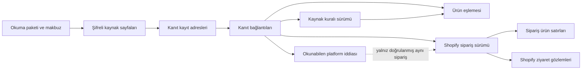

# 15. madde — veritabanının ilk temeli

Tarih: 2 Kasım 2026. Durum: ürün sahibine sunulan tablo ve ilişki önerisi.
Tablolar oluşturulmadı; SQL migration, writer veya canlı veri kaydı yapılmadı.
Makine karşılığı: `contracts/eo-05-step15-storage-design-v1.json`.

## Ne yapıyoruz?

Platformlardan okuduğumuz bilgileri işlem bitince kaybolmayacak şekilde saklayacak
temeli tasarlıyoruz. Bir kaydı tekrar bulabilmeli, nereden geldiğini gösterebilmeli
ve aynı veri tekrar geldiğinde ikinci satış üretmemeliyiz.

Örnek: Google ürün kimliği `G1`, doğrulanmış Shopify ürünü `P1` ile eşleşti.
Shopify siparişi `O1` içindeki `L1` satırı da `P1` ürününü içeriyor. Eşlemenin hangi
kurala ve hangi kaynak yanıtlarına dayandığını saklarız. Bu ilişki tek başına
Google'ın `O1` satışını kendisine yazdığının kanıtı değildir; okunabilen bir platform
iddiası varsa ayrıca saklanır. Kesin Overlap hesabı burada yapılmaz.

Mevcut kimlik, ilk hata, tekrar önleme, belirsiz sonuç, silme ve yeniden bağlantı
kararları kullanılır. Bu kurallar yeniden ürün kararına açılmaz.

## Kaç tablo öneriyoruz?

15 için **10 fiziksel tablo önerisi** var. `product_identity_mappings` önceki beş
mantıksal Dataset tablosundan biridir; ikinci bir eşleme tablosu değildir. Diğer
9 tablo kaynak, kanıt ve ilişki desteğidir. Önceki `pd_facts`,
`cpd_product_performance_facts`, `cpd_product_sales_facts`, `fx_rates` bu teslimde
kurulmaz; genel rapor/FX yazımı mevcut23'te kalır. Birlikte sayıldığında bu model
14 tablo öngörür; mevcut kurulum, hesap, kuyruk, kota, token ve silme tabloları bu
sayıya dahil değildir. Ek tablo sayısı açıkça incelemeye sunulur, onaylanmış sayılmaz.

| Tablo | Ne saklar? | Neye bağlanır? |
|---|---|---|
| `evidence.source_batches` | Hangi mağaza/hesap için hangi okumanın yapıldığı; tamlık ve kalıcı kayıt makbuzu | Mevcut kurulum/iş otoritesi |
| `evidence.source_pages` | İlgili sorgunun sınırlandırılmış ve arındırılmış şifreli kaynak yanıtı | Okuma paketi |
| `evidence.source_references` | Yanıtın içindeki hangi satırın/kaydın kanıt olduğu | Kaynak sayfası |
| `identity.source_rule_versions` | Kaynak ürün kimliğini yorumlayan doğrulanmış kural ve sürümü | Kabul edildiği paket ve kanıtları |
| `identity.product_identity_mappings` | Platform ürünü → Shopify ürünü/varyantı; doğrulanmış/çözülememiş/çelişkili durumu | Kural sürümü ve kanıtları |
| `source.shopify_order_versions` | Shopify siparişinin kaynak kimliği, sürümü ve gözlenen tutar/durumları | Okuma paketi ve kaynak kaydı |
| `source.shopify_line_versions` | Siparişin ürün satırı, adetleri, ürün/varyant kimliği ve kaynak tutarları | Tam olarak ilgili sipariş sürümü |
| `source.shopify_journey_versions` | Mevcut ilk/son ziyaret ve sayfalanmış kaynak gözlemleri; hazır/eksik durumu | Sipariş sürümü ve okuma paketi |
| `source.provider_claim_versions` | Gerçekte okunabilen platform satış/sipariş atıf iddiası | Kanıt; doğrulanırsa aynı Shopify siparişi |
| `evidence.source_reference_links` | Bir eşlemenin veya kaydın birden fazla kanıta dayanması | Somut kural/eşleme/sipariş/satır/ziyaret/iddia kayıtları |

Son bağlantı tablosu, serbest metinle “şu ID'ye bağlı” demez. Altı olası hedef
kolonundan yalnız biri dolar ve gerçek, mağaza kapsamlı foreign key ile korunur.
Kaynak sayfaları ileride rapor oluşturmak için bütün olarak taranıp çözülmez;
raporun ihtiyaç duyduğu doğrulanmış bilgiler kendi tablosundan okunur.

## Hangi ham bilgi nereye gidecek?

| Okunan bilgi | Kaynak/kanıt olarak | Kullanılabilir kayıt olarak |
|---|---|---|
| Google, Meta, Klaviyo performans/dönüşüm/ürün raporu | Sayfa, kayıt adresi, sorgu/sürüm ve tamlık bilgisi | Genel PD/CPD rapor yazımı23'te; bu aşamada rapor fact'i üretilmez |
| Merchant/feed/dil, katalog/retailer ve doğrulanmış Shopify ürün/varyant gözlemi | İlgili kaynak kayıtları | Kaynak kuralı ve eşleme; kanıt yoksa çözülememiş |
| Shopify sipariş başlığı | Siparişin alındığı kaynak kaydı | Sipariş sürümü; kaynak para birimleri ve tutarlar korunur |
| Shopify ürün satırı | Satırın kaynak kaydı | Sipariş sürümüne bağlı satır; Product ID satırın tekilleştirme anahtarı değildir |
| Mevcut Shopify ziyaret yanıtı | İlk/son ziyaret ve mevcut sayfalar | Ayrı ziyaret gözlemi; satış veya platform iddiası yerine geçmez |
| Gerçekte okunabilen Order/Message/atıf bağlantısı | İddianın özgün kaynak referansı | Ayrı platform iddiası; doğrulanmamış sipariş bağı boş ve durumu açık kalır |

Ham kanıt, bütün HTTP trafiğinin sınırsız kopyası değildir. İlgili sorgunun gerekli
kaynak alanları, iş anlamına çevrilmeden önce, sürümlü izinli-alan listesiyle alınır.
Token, cookie, yetki başlığı, gereksiz kişi/profil alanı, imzalı sayfalama URL'si ve
keyfî hata gövdesi saklanmaz. Arındırma sürümü ve kalan içeriğin özeti saklanır;
bu özetin atılmış özgün HTTP gövdesinin özeti olduğu iddia edilmez.

Kaydın doğrudan yanıt alanlarından mı, daha dar okuyucu çıktısından mı alındığı da
belirtilir. Okuyucunun taşımadığı bir alan native yanıtta yok sayılmaz. Native ondalık
metin korunur; JSON sayıları için exact kanıt gerekiyorsa kayıpsız token yakalama
gerekir. Önceden Number olarak çözülmüş değer özgün hassasiyetiyle yeniden
üretilmiş gibi gösterilmez. Bu ayrım uygulamanın kabul testinde kontrol edilir.

Shopify UTM/giriş sayfası/referrer/MarketingEvent ekleri ve iade satırı ayrıntıları
bu tasarımla istenmez. Ürün sahibinin 2 Kasım kararıyla bunların gerekliliği ve ek
ham veri olarak alınıp alınmayacağı, mevcut22 sonrası Overlap görüşmesindedir.
Plan kaydı PR294 ayrı ve henüz birleşmemiştir; bu branch güncel main'den açılmıştır.
Mevcut toplam iade alanı korunur; yeni iade özelliği veya hesaplama formülü kurulmaz.

## İlişki ve tekrar güvenliği

- Her kayıt workspace, gerçek kurulum PK'sı, kurulum nesli ve Shopify mağazasıyla
  bağlıdır. Reklam bağlantısı gereken yerde hesap, connection/version ve seçim
  sürümü ayrıca doğrulanır. Bağımsız Shopify siparişine sahte reklam hesabı eklenmez.
- İç PK `bigint identity`; uygulamaya kayıpsız ondalık metin olarak taşınır. Native
  kimlikler text kalır. Hesap adı, SKU, fiyat veya yakın tarih kimlik anahtarı değildir.
- Siparişin mantıksal kimliği mağaza + Order ID, satırınki buna ek LineItem ID'dir.
  Aynı native sürüm ve içerik yeniden gözlenirse aynı yapılandırılmış kayıt kullanılır;
  yeni okumanın kanıtı ayrıca bağlanır. Bu iki okuma iki satış sayılmaz.
- Aynı native sürümde farklı içerik gelirse üstüne yazmak yerine çelişki kaydedilir.
  Bir sonraki gerçek sürüm ayrı tutulur. Görülme zamanı, native geçerlilik başlangıcı
  gibi kullanılamaz; sistem geçmişteki bütün ara sürümleri gördüğünü iddia etmez.
- Eşleme anahtarı provider/hesap ve gerekli katalog/feed/dil/native bağlamını korur.
  Sürüm, canonical değer ve hash birlikte denetlenir; hash çakışması birleşme değil
  hata üretir. Yeni eşleme eski raporun kimliğini kendiliğinden değiştirmez.
- Birden fazla kanıt aynı kayda bağlanabilir. Farklı okumalardan kanıt kullanımı
  yalnız exact mağaza, bağlam, sürüm ve içerik doğrulamasıyla mümkündür. Yerel satır
  numarası kendi sayfa/paket/hash kapsamı dışında kalıcı kimlik değildir.
- İlişki kolonlarının indeksi, owner+native-key/sürüm indeksi ve süreli temizliğin
  indeksi tasarımda yer alır. Büyük JSON veya şifre çözülmüş bütün sayfaların taranması
  normal okuma yolu değildir. Boyut ve sorgu planları uygulamada ölçülür.

## Ham kanıtı nasıl koruyacağız?

İlk öneri, sınırlandırılmış kanıt sayfalarını PostgreSQL'de şifreli `bytea` olarak
saklamaktır. Bu, dosya deposu ile veritabanı arasında ikinci bir kayıt/silme
protokolü kurmayı önler. Gerçek boyut ölçümü bunu karşılamazsa ayrı nesne deposu
alternatifi yeniden değerlendirilir; bu tasarımla bucket oluşturulmaz.

AES-256-GCM zarfı; mağaza/kurulum/paket/sayfa/sürüm/içerik bağını doğrular. Token ve
session anahtarları kullanılmaz. Mevcut token şifreleyicisinin kabul etmediği yeni
amaç ona zorla eklenmez; ayrı amaç ve anahtar alanı gerekir. Bu teslim anahtar
üretmez veya env/config değiştirmez. Normal ekran/rapor cevabı ham gövde veya decrypt
yetkisi taşımaz. Mevcut owner/coordinator/runtime rol ayrımı korunur; public, anon,
authenticated ve service_role için yeni tablo erişimi önerilmez.

Tablolar özel schema'da, ENABLE/FORCE RLS ve kapsamlı iç SQL fonksiyonlarıyla
korunacaktır. İstemcinin workspace/rol bilgisi veya değiştirilebilir session ayarı
yetki sayılmaz. Tüm FK'lar owner kapsamını da doğrular; yalnız bigint eşitliği yetmez.

Her veri sınıfının politika sürümü ve son kullanma zamanı bulunur. “Sonsuza kadar”
varsayılanı yoktur. Sayısal süreler ve byte/satır bütçeleri bu tablo önerisiyle keyfî
seçilmez; mevcut ölçüm/kapasite ve saklama politikası kapısında canlı saklamadan önce
kesinleşir. Süresi dolan kanıt kullanılamıyor diye gösterilir; varmış gibi kabul
edilmez. Süresi dolan kanıta bağlı eşleme/kural yeni kullanımda taze doğrulama
olmadan geçerli kabul edilmez. Hâlâ gereken kanıtın silinmesi kontrollü politika kararı olmadan FK cascade
ile tetiklenmez. Gerçek silme talepleri bu korumadan üstündür.

## Yazma, tekrar okuma ve yarıda kalma

1. Mevcut doğrulanmış kaynak gözlemi ve güncel mağaza/hesap/iş yetkisi kontrol edilir.
2. Kaynak sayfaları sınırlandırılmış bir paket içinde hazırlanır. Hazırlanmış veya
   kalıcı saklanmış olması, kaynağın tam veya doğrulanmış olduğu anlamına gelmez.
3. Tek sınırlı transaction içinde güncel yetki yeniden denetlenir; sayfa/referans,
   kural/eşleme ve sipariş/atıf kayıtları ile bağlantıları yazılır veya aynı olduğu
   doğrulanır. Paket manifesti ve kayıt makbuzu aynı işlemde tamamlanır.
4. Tekrar okumada exact işlem kimliği, içerik özeti, mağaza ve kayıt sayıları
   karşılaştırılır. Aynı işlem/farklı içerik üzerine yazılamaz.
5. Cevap kaybolursa otomatik tekrar yazılmaz. Mevcut belirsiz-sonuç kuralıyla açık,
   salt okunur makbuz kontrolü yapılır. Makbuzun yokluğu rollback kanıtı değildir.
6. Kısmi okumanın eldeki kanıtı eksik durumuyla korunabilir; tamamlandı veya
   yayınlanabilir yapılmaz. Kapasite/fence kilitleri yalnız saklama makbuzu var diye
   bırakılmaz. Başarısız/belirsiz native çağrı otomatik tekrarlanmaz.

Bu paketin kaynak kayıt makbuzu ile23'teki genel Dataset checkpoint'i farklıdır.
Raporun kalıcı yazımı yapılmadan rapor işaretçisi ilerletilmez. Mevcut iş/kota
altyapısının kilit sırası ve release kuralları uygulamada korunacaktır.

## Silme ve yeniden bağlantı

Disconnect mevcut OAuth protokolüyle bağlantıyı keser; bu tasarım o protokolü
değiştirmez. İzin verilen tarihsel kayıtlar mevcut saklama politikasına göre kalır.
Yeni connection version veya kurulum nesli eski eşlemeyi otomatik etkinleştirmez.
Yeni kullanım taze doğrulama ister; geçmiş kayıtlar kendi kapsamıyla okunur.

Onaylanmış veri silme ve Shopify gizlilik akışında bu10 tablo, bağlantılar ve şifreli
içerik mevcut durable silme manifestine/worker'ına dahil edilir. Yeni silme motoru
kurulmaz. Silme isteği, append-only geçmiş kuralının önündedir. Yedekten dönüşte
mevcut silme defteri tekrar uygulanmadan hizmet açılmaz.

## Neyi sınayacağız?

Farklı mağaza/kurulum/nesil bağlantısı reddi; aynı işlemin tekrarı; aynı sürüm/farklı
içerik; değişmiş hesap/seçim yetkisi; transaction ortasında hata; kayıt cevabı kaybı;
kısmi okuma; eksik ürün/ziyaret; doğrulanmamış claim; şifre/hash/AAD bozulması;
Disconnect ve reconnect sonrası yetki; silme/yedekten dönüş; süre aşımı ve gerçek
boyut/sorgu planı. Bunlar yalnız belgeyi tekrar eden testler değil, sonraki SQL ve
writer uygulamasının davranış kabul koşullarıdır. Bu teslim test edilmiş bir DB
uygulaması veya gerçek provider veri kabulü değildir.

## Bu teslimin karar ve uygulama sınırı

Şimdi incelenecek somut sonuç:10 tabloluk yerleşim, alanlar ve ilişkiler. Makine
sözleşmesi her tablonun kolon, tekillik, FK ve indeks adaylarını içerir. Tablo
yerleşimi ürün sahibi tarafından kabul edilmeden SQL/migration/writer hazırlığına
geçilmez; bu kapı mevcut26-adımlı planın15. satırından gelir. Kabulden sonra repository
uygulaması ve izole testler hazırlanır. Merge, canlı DB apply, anahtar/config,
provider çağrısı ve yayın için mevcut ayrı açık onay kapıları devam eder.

15'in tamamı bitmedi; yalnız ilk tasarım önerisi hazırlandı.22 tarihsel PMax paused,
23 genel Dataset/FX yazımı, Overlap22 sonrasında kalır. Yeni sorgu veya OAuth adımı
eklenmez; Merchant/business/catalog seçimi geri getirilmez.

Resmî kontrol tarihi2 Kasım2026: [Supabase tablolar](https://supabase.com/docs/guides/database/tables),
[RLS](https://supabase.com/docs/guides/database/postgres/row-level-security),
[PostgreSQL17 constraints](https://www.postgresql.org/docs/17/ddl-constraints.html),
[transaction isolation](https://www.postgresql.org/docs/17/transaction-iso.html),
[privileges](https://www.postgresql.org/docs/17/ddl-priv.html).
Supabase changelog.md araçta desteklenmeyen text/markdown biçimi nedeniyle okunamadı;
alternatif rota denenmedi. Tam changelog kontrolü uygulama öncesi açık kalır. Kaynaklar
mekanizmaları açıklar; bu AdsTable modelini veya canlı kapasiteyi onaylamaz.
